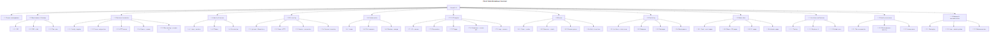
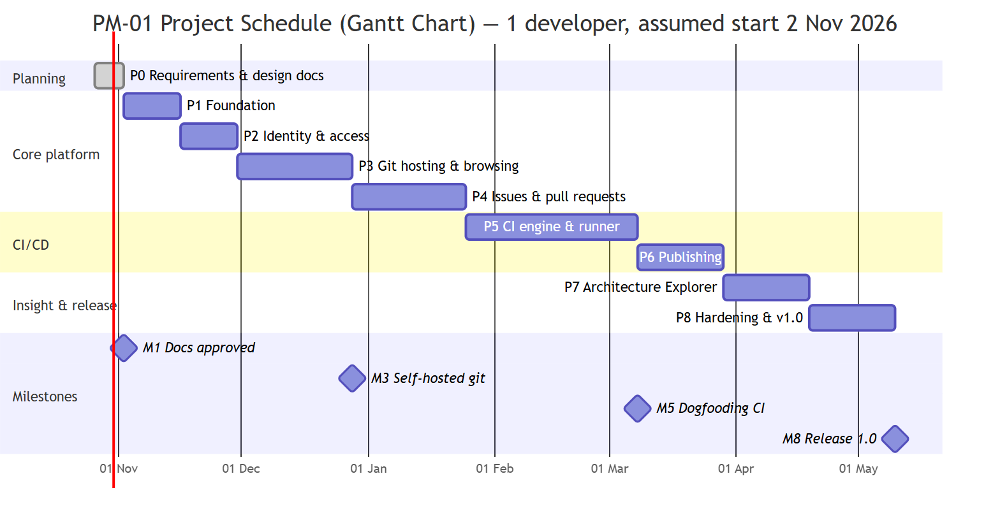

# Software Project Management Plan (SPMP)

**Project:** Anvil — Self-Hosted Code Forge and CI/CD Platform
**Document ID:** ANV-SPMP-001 · **Version:** 1.0 (Draft for approval) · **Date:** 2026-10-30
**Standard:** ISO/IEC/IEEE 16326:2019 (Project management), structure following IEEE 1058

## Document Control

| Version | Date | Author | Change |
|---|---|---|---|
| 1.0 | 2026-10-30 | Project team | Initial plan: phases, WBS, schedule, risks, processes |

| Role | Name | Signature / Date |
|---|---|---|
| Product Owner / Sponsor | SAZZAD-HT | |
| Project Manager / Tech Lead | | |

---

## 1. Overview

### 1.1 Purpose, Scope and Objectives
Deliver Anvil 1.0 as specified in [ANV-SRS-001](01-SRS-Software-Requirements-Specification.md): a self-hosted forge with GitHub-style collaboration and GitLab-style CI/CD that runs natively on Windows and Linux.

**Objectives**

| ID | Objective | Measure |
|---|---|---|
| OBJ-1 | Ship all Must requirements | 100% Must test cases pass ([STP §3](03-STP-Software-Test-Plan.md)) |
| OBJ-2 | Cross-platform | Full test suite green on Windows and Linux |
| OBJ-3 | Teachable codebase | 100% documentation coverage; onboarding ≤ 5 days |
| OBJ-4 | On schedule | Release 1.0 by **10 May 2027** (±3 weeks) |

### 1.2 Assumptions and Constraints
One experienced full-time developer (estimates scale to ~60% duration with a second, frontend-focused developer). Constraints CON-1…CON-6 of the SRS apply. No budget for paid services is required: all tooling is open source.

### 1.3 Project Deliverables

| Deliverable | Format | Due |
|---|---|---|
| SRS, SDD, STP, SPMP, RTM + UML diagrams | Markdown + SVG/PNG in `docs/` | M1 (2 Nov 2026) |
| `anvil` and `anvil-runner` binaries (Windows/Linux, x64/ARM64) | zip / tar.gz + SHA-256 checksums | M8 |
| Web client | Embedded in `anvil` | M8 |
| Installation, administrator and user guides | Markdown + in-app help | M8 |
| API reference (OpenAPI), generated code reference | HTML | M8 |
| Test reports per phase, Test Summary Report | Markdown | Each phase / M8 |
| Demo application with pipelines in both formats | Repository `examples/demo-app` | M6 |

---

## 2. Project Organisation

### 2.1 Roles and Responsibilities

| Role | Responsibilities | Assigned |
|---|---|---|
| Product Owner | Approves requirements, priorities and phase acceptance | SAZZAD-HT |
| Tech Lead / Project Manager | Plan, architecture, reviews, risk management | TBD |
| Backend Developer | Go server and runner | TBD |
| Frontend Developer (optional) | React client, Explorer | TBD |
| QA (may be shared role) | Test plan, system tests, reports | TBD |

### 2.2 Interfaces
The Product Owner reviews each phase demo. Users/testers are invited for acceptance at M5 (dogfooding) and M8.

---

## 3. Managerial Process

### 3.1 Lifecycle Model
**Incremental, phase-gated.** Each phase delivers a working, demoable increment with its tests and docs. Inside a phase, work runs in one-week iterations with a short review. A phase may start only when the previous phase's exit criteria are met (except P7, which may overlap — see §3.3).

### 3.2 Work Breakdown Structure

*Figure 3-1 — Work breakdown structure ([source](diagrams/src/PM-02-work-breakdown-structure.mmd))*

### 3.3 Phases, Effort and Exit Criteria

| Phase | WBS | Effort | Dates (1 dev) | Exit criteria | Test cases |
|---|---|---|---|---|---|
| **P0** Requirements & design | 1.2 | 1 wk | done 30 Oct 2026 | SRS/SDD/STP/SPMP/RTM approved | — |
| **P1** Foundation | 1.3 | 2 wk | 2 Nov – 15 Nov 2026 | `anvil init && serve` on Win + Linux; project CI green on both | TC-SMK-01, TC-ADM-04/07 |
| **P2** Identity & access | 1.4, 1.10.1 | 2 wk | 16 Nov – 29 Nov 2026 | Login, PATs, permissions; security tests pass | TC-AUTH-* |
| **P3** Git hosting & browsing | 1.5, 1.10.2 | 4 wk | 30 Nov – 27 Dec 2026 | Clone/push/protection/browse on both OSes; 1 GB repo | TC-REPO-* |
| **P4** Issues & pull requests | 1.6 | 4 wk | 28 Dec 2026 – 24 Jan 2027 | PR flow incl. conflicts and concurrent merge | TC-COL-* |
| **P5** CI engine & runner | 1.7, 1.8, 1.10.3 | 6 wk | 25 Jan – 7 Mar 2027 | Demo pipeline passes in both formats on both OSes; claim race test ×1000; **Anvil builds itself** | TC-CI-* |
| **P6** Publishing | 1.9 | 3 wk | 8 Mar – 28 Mar 2027 | Tag → multi-OS build → release → manual deploy | TC-PUB-* |
| **P7** Architecture Explorer | 1.11 | 3 wk | 29 Mar – 18 Apr 2027 | Live push trace end to end; onboarding Day 1 via Explorer | TC-EXP-* |
| **P8** Hardening & release | 1.12, 1.13 | 3 wk | 19 Apr – 9 May 2027 | All release criteria in STP §3 | All, TC-NFR-* |
| **Total** | | **28 wk** | | | |

### 3.4 Schedule

*Figure 3-2 — Schedule and milestones ([source](diagrams/src/PM-01-schedule-gantt.mmd))*

| Milestone | Date | Meaning |
|---|---|---|
| M1 Docs approved | 2 Nov 2026 | Baseline requirements and design |
| M3 Self-hosted Git | 27 Dec 2026 | Anvil can host its own repository |
| M5 Dogfooding CI | 7 Mar 2027 | Anvil's own CI runs on Anvil (Windows + Linux runners) |
| M8 Release 1.0 | ~10 May 2027 | Released by Anvil's own pipeline |

### 3.5 Risk Management

Risks are reviewed weekly. Score = Probability (1–3) × Impact (1–3).

| ID | Risk | P | I | Score | Mitigation | Contingency | Owner |
|---|---|---|---|---|---|---|---|
| RK-1 | Windows process/file-locking edge cases make the runner flaky | 3 | 3 | 9 | Isolate in `procgroup`/`fsutil`; Windows stress tests from P1 | Add 1 week buffer to P5 | Tech Lead |
| RK-2 | Scope creep in GitHub/GitLab syntax compatibility | 3 | 2 | 6 | Fixed supported subset (SRS App. A); everything else → clear error | Move features to post-1.0 | Product Owner |
| RK-3 | No container isolation leads to security concerns | 2 | 3 | 6 | Dedicated runner users, protected labels, fork approval, clear docs | Prioritise Docker executor after 1.0 | Tech Lead |
| RK-4 | SQLite write contention under CI load | 2 | 2 | 4 | Single writer, short transactions, load tests in P8 | PostgreSQL driver post-1.0 | Backend Dev |
| RK-5 | Estimates too optimistic (single developer) | 2 | 3 | 6 | Phase reviews re-estimate; Could items dropped first | Add second developer for P5–P7 | Project Manager |
| RK-6 | Git version differences on user machines | 1 | 2 | 2 | Minimum 2.38 enforced at startup; CI with min + latest Git | Document workaround | Backend Dev |
| RK-7 | Documentation drifts from code | 2 | 2 | 4 | Lint gates, docs tests, PR checklist | Docs sprint before release | Tech Lead |
| RK-8 | Key-person dependency | 2 | 3 | 6 | Complete docs + onboarding make handover possible | — | Product Owner |

### 3.6 Monitoring and Control

| Mechanism | Frequency | Output |
|---|---|---|
| Iteration review | Weekly | Done/not done list, updated risks |
| Phase review and demo | End of phase | Acceptance by Product Owner; re-estimate remaining phases |
| Metrics | Continuous (CI) | Test pass rate per OS, coverage, open defects by severity, doc-coverage violations |
| Change control | On request | Change request → impact on scope/schedule → Product Owner decision → SRS/SPMP version update |

### 3.7 Staffing Plan
Phases P1–P8 can be done by one developer. If a second developer joins, assign them to the web client (WBS 1.10) and Explorer (1.11) from P3 onward, overlapping P7 with P5–P6.

---

## 4. Technical Process

| Area | Choice |
|---|---|
| Methods | Requirements in SRS with IDs; design per IEEE 1016 viewpoints; test-first for bug fixes |
| Languages | Go (server, runner), TypeScript/React (client) |
| Tools | Git, Go toolchain, Node.js 24 (build only), golangci-lint, ESLint, Vitest, Playwright, Mermaid CLI |
| Infrastructure | GitHub Actions matrix (Windows + Linux) until M5, then Anvil itself |
| Coding standards | Go: `gofmt`, golangci-lint; TS: ESLint + Prettier; doc standards in [reference/15](reference/15-documentation-standards.md) |
| Repository structure | [reference/14-code-structure.md](reference/14-code-structure.md) |

---

## 5. Supporting Processes

### 5.1 Configuration Management
- **Repository:** single Git repository; `main` always releasable; work on short-lived branches merged by pull request with one review.
- **Versioning:** Semantic Versioning (`MAJOR.MINOR.PATCH`); release tags `vX.Y.Z`.
- **Baselines:** documents are baselined at M1; changes after baseline require a new document version and a Document Control entry.
- **Change requests:** recorded as issues labelled `change-request`, decided by the Product Owner.

### 5.2 Quality Assurance
Code review on every PR; automated lint, tests and architecture checks on Windows and Linux; phase acceptance by the Product Owner; STP exit criteria for release.

### 5.3 Verification and Validation
Verification per [STP](03-STP-Software-Test-Plan.md); validation through phase demos and dogfooding from M5.

### 5.4 Documentation
| Document | Owner | Updated |
|---|---|---|
| SRS / SDD / STP / SPMP / RTM | Tech Lead | On change request; reviewed each phase |
| UML diagrams (`docs/diagrams/src`) | Author of the design change | Same PR as the change |
| Code documentation | Every developer | Same PR as the code |
| CHANGELOG | Every developer | Every user-visible change |

### 5.5 Problem Resolution
Defects are issues with severity (STP §3) and the affected OS. Critical/High defects block the phase exit. Root cause is recorded for Critical defects.

---

## 6. Post-1.0 Backlog (not scheduled)

SSH transport · organisations and teams · webhooks · optional Docker executor · CI cache and schedules · PostgreSQL · OCI/npm/NuGet/PyPI registries · Git LFS · mirroring · OpenTelemetry export · wiki/boards · official macOS support. Details: [reference/17-roadmap.md §4](reference/17-roadmap.md).
