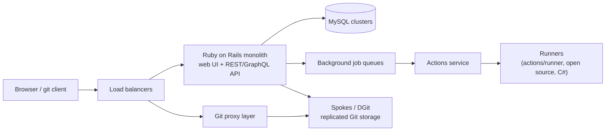
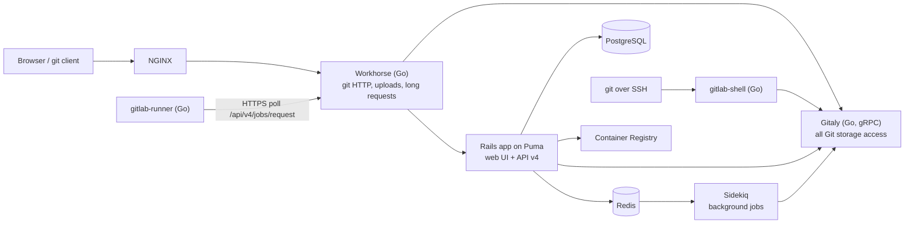
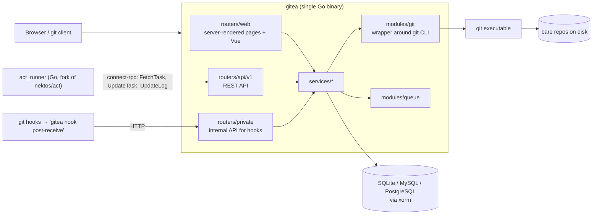

# 01 — Research: How GitHub, GitLab and Gitea Work

Before designing Anvil we studied the existing systems. This document records what we learned and **which ideas we borrow**, so later decisions can be traced back to evidence.

## 1. Survey of open-source forges (GitHub star counts, 30 Oct 2026)

Collected through the GitHub search API, sorted by stars:

| Stars | Project | Language | Notes |
|---:|---|---|---|
| 58,776 | go-gitea/gitea | Go | Most popular self-hosted forge. Single binary. Includes Actions CI, packages, wiki. MIT. |
| 47,912 | gogs/gogs | Go | Gitea's ancestor (Gitea forked from it in 2016). Small, no built-in CI. |
| 7,836 | go-git/go-git | Go | Pure-Go Git implementation (a library, not a forge). |
| 2,750 | PGYER/codefever | PHP | Small forge, mostly Chinese-language community. |
| 1,838 | Bonobo-Git-Server | C# | Windows/IIS only, basic features. |
| 228 | Pagure | Python | Fedora's forge, based on pygit2. |

GitLab CE is developed on gitlab.com rather than GitHub, so it does not appear in GitHub's ranking, but it is the most widely deployed open-source forge in companies.

Related tools for analysing and visualising code architecture: `ahmedkhaleel2004/gitdiagram` (18.6k stars), `CodeBoarding/CodeBoarding` (2.6k), `glato/emerge` (1.2k). These informed the **Architecture Explorer** idea ([09](09-frontend-architecture.md)).

**Conclusion:** Gitea is the best reference for a single-binary forge, and its Go codebase is the most approachable to study. GitLab is the reference for CI/CD concepts (`.gitlab-ci.yml`, stages, runner protocol, release and package features).

## 2. How GitHub works (from public information)

GitHub's server code is closed source; this summary comes from GitHub's engineering blog and public talks.

What matters for us:

- **Workflow file format** (`.github/workflows/*.yml`): `on:` triggers, `jobs:` with `needs:`, `runs-on:` labels, `steps:` with `run:` or `uses:`. This format is public and widely known, so Anvil accepts a subset of it.
- **Runner model:** runners are separate programs that *pull* jobs from the server over HTTPS. The server never connects to the runner. This works through firewalls and NAT, and we copy it.
- **Pull request refs:** each PR is exposed as `refs/pull/<n>/head`. We copy this convention.

## 3. How GitLab works (open source, well documented)

GitLab is a set of cooperating services:

What we learned:

- **Gitaly** puts *all* Git disk access behind one service. Anvil does the same thing in-process: only the `internal/git` package may touch repositories on disk.
- **Workhorse** exists because Ruby is slow at streaming large bodies. Anvil is written in Go, so streaming happens directly in the main server and needs no separate proxy.
- **Runner protocol:** the runner long-polls `POST /api/v4/jobs/request`, sends log chunks with `PATCH /api/v4/jobs/:id/trace` and a `Content-Range` header (so a resent chunk is never duplicated), and reports its final state with `PUT /api/v4/jobs/:id`. Anvil's runner protocol ([07](07-ci-cd-design.md)) follows the same shape.
- **Executors:** gitlab-runner supports a `shell` executor that runs jobs directly on the host, including with PowerShell on Windows. This proves Docker-less CI is practical; Anvil's runner is a shell executor.
- **`.gitlab-ci.yml`**: `stages:`, jobs with `stage:`, `script:`, `before_script:`, `needs:`, `rules:`, `artifacts:`, `release:`. Anvil accepts a subset.
- **Generic package registry:** `PUT /projects/:id/packages/generic/:name/:version/:file`. A simple design that Anvil copies.
- **Cost:** GitLab needs 4 GB+ RAM and only runs on Linux, which is exactly the problem Anvil solves.

## 4. How Gitea works (open source, our closest reference)

What we learned:

- **Calling the `git` program** instead of reimplementing Git keeps behaviour identical to standard Git and is fast. Gitea's `modules/git` wraps `git` and keeps long-running `git cat-file --batch` processes for reading many objects. We copy this.
- **The hook loop-back pattern:** when someone pushes, `git receive-pack` runs a hook script, which runs `gitea hook post-receive`, which calls back into the running server over a private HTTP API. That is how the server finds out a push happened. Anvil uses the same pattern ([04](04-git-hosting.md)).
- **Single binary with embedded assets:** templates and frontend are built into the executable, which makes installing very easy. We copy this, with a React single-page app instead of server-rendered templates.
- **act_runner** runs GitHub Actions by default in Docker. Its "host" mode runs on the bare machine, but marketplace actions assume Linux and Node. Anvil avoids that problem by emulating a small set of built-in actions natively.

## 5. Decisions borrowed

| Idea | Source | Where in Anvil |
|---|---|---|
| Single binary, embedded web assets, SQLite default | Gitea | [02](02-tech-stack-decisions.md), [11](11-configuration-and-operations.md) |
| Call the `git` CLI; one package owns all disk access | Gitea `modules/git`, GitLab Gitaly | `internal/git`, [04](04-git-hosting.md) |
| Server hooks call back to an internal API | Gitea `routers/private` | `internal/git/hooks`, [04](04-git-hosting.md) |
| Runners pull jobs via HTTPS long-poll | GitHub, GitLab, Gitea | [07](07-ci-cd-design.md) |
| Idempotent log upload with byte offsets | gitlab-runner trace API | [07](07-ci-cd-design.md) |
| Shell executor on the host (PowerShell / bash) | gitlab-runner `shell` executor | `internal/runner/executor` |
| `.github/workflows` format (subset) | GitHub Actions | [07](07-ci-cd-design.md) |
| `.gitlab-ci.yml` format (subset), stages, `release:` keyword | GitLab CI | [07](07-ci-cd-design.md), [08](08-publishing.md) |
| `refs/pull/<n>/head` | GitHub | [04](04-git-hosting.md) |
| Generic package registry | GitLab | [08](08-publishing.md) |
| Issues and PRs share one number sequence per repo | GitHub, Gitea | [05](05-data-model.md) |

## 6. Ideas deliberately rejected

| Idea | Why not |
|---|---|
| Reimplement Git with a pure-Go library (go-git) as the main engine | go-git lags behind real Git (protocol v2, partial clone, performance). We still call the `git` binary, which every user already has. |
| Microservices like GitLab | Too heavy for a laptop, and harder to learn from. A *modular monolith* gives the same separation inside one process. |
| Run marketplace GitHub Actions | Needs Node plus Linux-specific tooling and pulls code from the internet at run time. Not portable and a security risk. |
| Server-rendered templates like Gitea | A React SPA plus a public REST API makes the API the single contract, and the Architecture Explorer needs a rich interactive UI anyway. |
