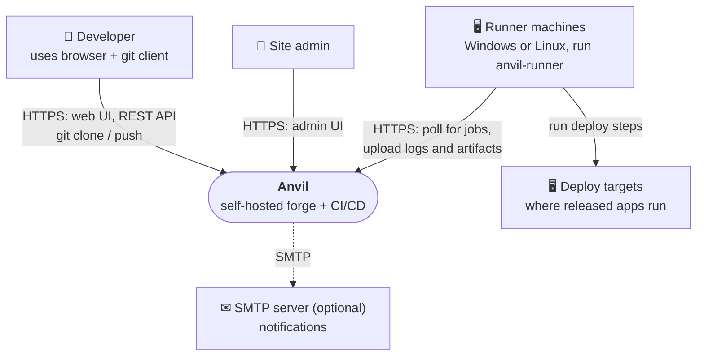
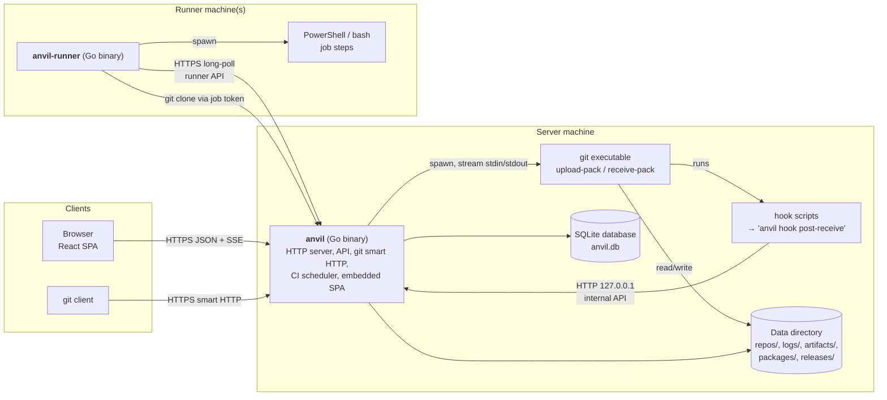
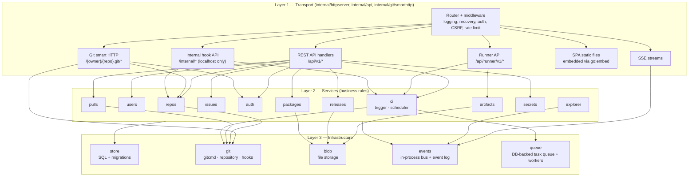
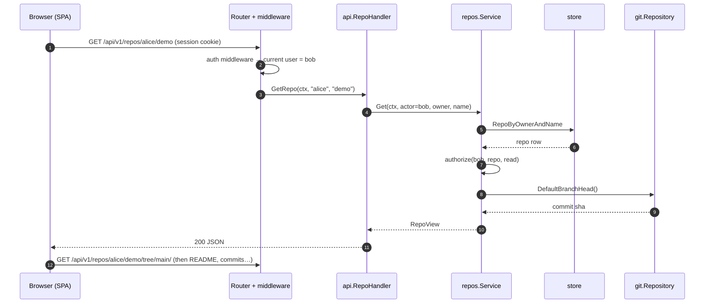
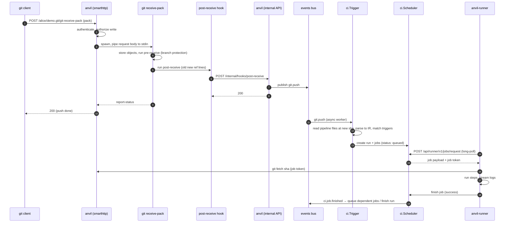

# 03 — Architecture Overview

This document describes Anvil at four zoom levels, following the [C4 model](https://c4model.com/): **context** (Anvil and the world), **containers** (the programs and data stores), **components** (modules inside the server), and **flows** (how a request moves through them). Detailed designs for each area are linked at the end of each section.

## 1. System context



- All traffic goes **into** Anvil over HTTP(S). Anvil never opens connections to runners, so runners can sit behind NAT or firewalls.
- A deploy target is simply a machine running a runner with a `deploy` label. Anvil has no special deploy protocol ([08](08-publishing.md)).

## 2. Containers (programs and data stores)



| Container | Technology | Responsibility |
|---|---|---|
| `anvil` | Go, single binary | Everything server-side: web, API, Git hosting, CI orchestration, storage |
| SPA | React + TypeScript, embedded in `anvil` | The user interface |
| `git` | Git ≥ 2.38 | Pack negotiation and object storage. Anvil never writes Git objects itself. |
| Hook scripts | `sh` scripts installed into each bare repo | Tell `anvil` about pushes; enforce branch protection |
| SQLite DB | `modernc.org/sqlite` | All metadata: users, repos, issues, PRs, runs, jobs, releases |
| Data directory | Filesystem | Bare repos, job logs, artifacts, release assets, package files |
| `anvil-runner` | Go, single binary | Fetches jobs, checks out code, runs steps, streams logs, uploads artifacts |

## 3. Components inside `anvil`

The server is a **modular monolith**: one process, separated into layers with one-way dependencies.



### Dependency rules (enforced by a test, see [14](14-code-structure.md))

1. Layer 1 may import Layer 2 and Layer 3. Layer 2 may import Layer 3 and *other services only through interfaces*. Layer 3 imports nothing from Layers 1–2.
2. **Only `internal/git` touches repository directories. Only `internal/store` runs SQL. Only `internal/blob` touches the data directory outside `repos/`.**
3. Handlers contain no business logic: they decode the request, call one service method, and encode the result.
4. Services never import `net/http`. They take a `context.Context` and plain Go types, and return domain errors (`ErrNotFound`, `ErrForbidden`, …) that Layer 1 maps to HTTP status codes.

## 4. Key flows

### 4.1 Browser loads a repository page



### 4.2 `git push` → pipeline → release (end-to-end, high level)

This is the most important flow in the system. Every step is detailed in [04](04-git-hosting.md) and [07](07-ci-cd-design.md).



The client's `git push` returns at step 10. Everything after that runs **asynchronously**, so a slow pipeline never blocks a push.

### 4.3 Startup sequence of `anvil serve`

1. Load config (`anvil.toml`, then environment overrides) and validate it. Exit with a clear message on error.
2. Check `git --version` is at least 2.38. Exit if not.
3. Open the database, apply pending migrations, run integrity checks.
4. Ensure data directories exist. Check every repository has current hook scripts and reinstall them if the Anvil version changed.
5. Start the event bus, the task queue workers, and the CI background loops (timeout reaper, artifact expiry).
6. Start the main HTTP listener and the internal listener (`127.0.0.1` only).
7. On SIGINT/SIGTERM (Windows: Ctrl+C or service stop): stop accepting requests, wait up to 30 s for in-flight requests and pushes, stop workers, close the DB.

## 5. Concurrency model

| Activity | Runs in | Notes |
|---|---|---|
| HTTP request | one goroutine per request (Go `net/http`) | Context cancelled when the client disconnects |
| `git upload-pack` / `receive-pack` | child process per request | Killed if the request context is cancelled |
| Long-poll from runners | request goroutine waits on a per-label notification channel | Woken immediately when a matching job is queued; times out after 30 s |
| Pipeline triggering | queue worker pool (default 4 workers) | Tasks stored in DB, so they survive a restart |
| DB writes | single writer connection (SQLite) | Short transactions only; never hold a transaction across a `git` call |
| SSE subscribers | request goroutine reading from an event-bus subscription | Slow subscribers are dropped rather than slowing the bus |

## 6. Event bus

Every important state change is published as an **event**: an in-process notification plus a row in the `events` table.

```go
// Event is one thing that happened in the system.
type Event struct {
    ID        int64          // monotonic, also used as SSE Last-Event-ID
    Type      string         // e.g. "git.push", "ci.job.started"
    RepoID    int64          // 0 for instance-wide events
    ActorID   int64          // user or runner that caused it
    Payload   map[string]any // type-specific data, documented in the event catalog
    CreatedAt time.Time
}
```

Consumers: the CI trigger (on `git.push`, `pull.opened`, `pull.synchronized`, `tag.created`), the activity feed, notifications, and the **Architecture Explorer**, which shows events moving through the system diagram in real time.

**Event catalog** (each payload is documented in `internal/events/catalog.go`):

| Type | Emitted by | When |
|---|---|---|
| `git.push` | internal hook API | after `post-receive`, one event per updated ref |
| `git.tag.created` / `git.branch.deleted` | internal hook API | ref created/deleted |
| `repo.created` / `repo.deleted` | repos | — |
| `issue.opened` / `issue.closed` / `issue.commented` | issues | — |
| `pull.opened` / `pull.synchronized` / `pull.merged` / `pull.closed` | pulls | — |
| `ci.run.created` / `ci.run.finished` | ci | — |
| `ci.job.queued` / `ci.job.started` / `ci.job.finished` | ci | — |
| `runner.online` / `runner.offline` | ci | heartbeat seen / missed |
| `release.published` | releases | — |
| `package.published` | packages | — |

## 7. Where to read next

| Topic | Document |
|---|---|
| How Git requests and hooks work | [04-git-hosting.md](04-git-hosting.md) |
| Tables and files | [05-data-model.md](05-data-model.md) |
| Endpoints | [06-api-spec.md](06-api-spec.md) |
| Pipelines and runners | [07-ci-cd-design.md](07-ci-cd-design.md) |
| Package-by-package reference | [14-code-structure.md](14-code-structure.md) |
