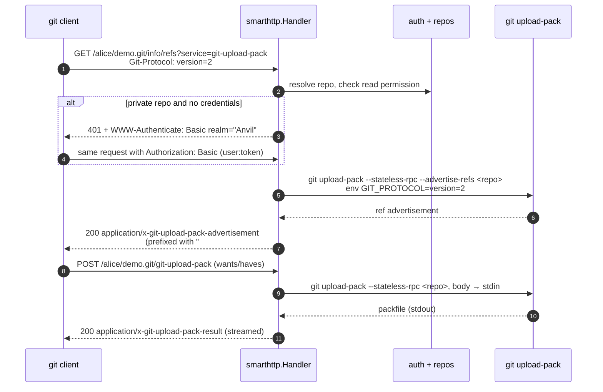
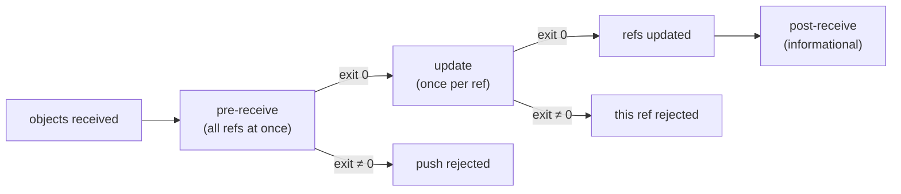
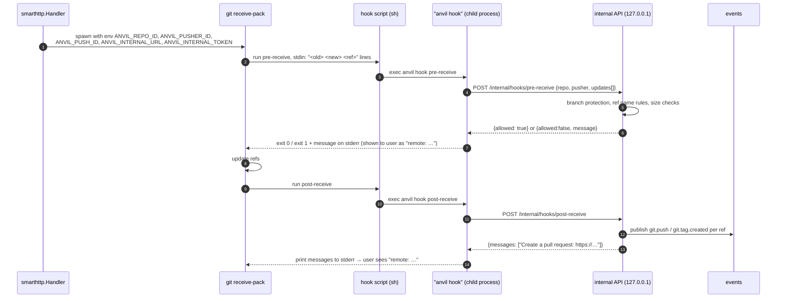
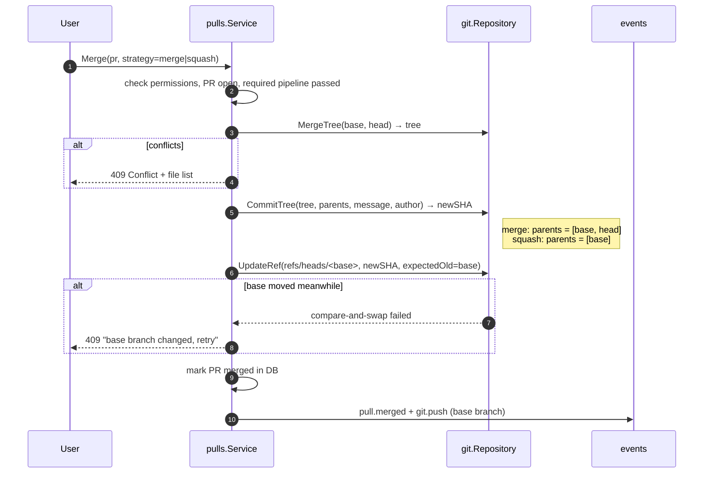

# 04 — Git Hosting Internals

This document explains how Anvil stores repositories and serves `git clone`, `git fetch` and `git push`. It is the part of a forge that most developers have never seen from the inside, so it starts with the protocol itself.

## 1. Storage layout

Every repository is a **bare** Git repository on disk:

```
<data_dir>/repos/<owner>/<name>.git/
├── HEAD                 # "ref: refs/heads/main"
├── config
├── objects/             # all commits, trees, blobs (managed by git)
├── refs/heads/…         # branches
├── refs/tags/…          # tags
├── refs/pull/<n>/head   # pull request heads (written by Anvil)
└── hooks/
    ├── pre-receive      # installed by Anvil
    ├── update           # installed by Anvil
    └── post-receive     # installed by Anvil
```

- Owner and repository names are lower-cased on disk and validated against `^[a-z0-9][a-z0-9._-]{0,99}$`. Names ending in `.git`, and the reserved names `.`, `..` and `api`, are rejected. This prevents path traversal and Windows-reserved names ([12](12-cross-platform.md)).
- The database stores the repo's numeric ID. **Renaming a repo renames the directory inside a DB transaction**: rename the directory, update the DB row, and roll back the directory rename if the commit fails.

### Creating a repository

`repos.Service.Create` → `git.InitBare(path, defaultBranch)` which runs:

```
git init --bare --initial-branch=<defaultBranch> <path>
git -C <path> config receive.denyNonFastForwards false
git -C <path> config core.quotePath false
```

…then `hooks.Install(path)` writes the hook scripts.

## 2. The Git smart HTTP protocol

When you run `git clone https://anvil.example.com/alice/demo.git`, Git speaks the **smart HTTP protocol**. There are only three URLs:

| Request | Purpose |
|---|---|
| `GET /alice/demo.git/info/refs?service=git-upload-pack` | "What refs do you have?" (clone/fetch) |
| `POST /alice/demo.git/git-upload-pack` | "Send me these objects" (clone/fetch) |
| `GET /alice/demo.git/info/refs?service=git-receive-pack` | "What refs do you have?" (push) |
| `POST /alice/demo.git/git-receive-pack` | "Here are new objects; update these refs" (push) |

The server does not need to understand pack files. It authenticates the user, then **pipes the HTTP body into the real `git` program and pipes its output back**. Git does all the hard work.

### 2.1 Clone/fetch sequence



### 2.2 pkt-line format, in brief

Git frames every message as a **pkt-line**: 4 hex digits giving the total length (including those 4 bytes), then the data. `0000` is a *flush packet* (end of section).

```
001e# service=git-upload-pack\n     ← 0x1e = 30 bytes
0000                                 ← flush
```

Anvil writes exactly one pkt-line itself (the `# service=…` header on v0/v1 `info/refs` responses). Everything else is produced by `git`. The helper `smarthttp.writePktLine` is documented and unit-tested against byte-exact fixtures.

### 2.3 Implementation rules for `internal/git/smarthttp`

| Rule | Why |
|---|---|
| Decode `Content-Encoding: gzip` request bodies before piping to git | Git clients gzip large requests |
| Pass the `Git-Protocol` header as the `GIT_PROTOCOL` environment variable | Enables protocol v2 (faster ref negotiation) |
| Set `Cache-Control: no-cache` on all responses | Ref advertisements must never be cached |
| Stream: never buffer a pack in memory | Packs can be gigabytes |
| Kill the git process when the request context is cancelled | Client hung up; free resources |
| Limit request body size (`git.max_push_size`, default 2 GiB) | Protects disk |
| Use `--stateless-rpc` | HTTP is stateless: each POST is a full exchange |
| Never interpolate user input into args; always end options with `--` | Argument injection ([10](10-security.md)) |

### 2.4 Authentication for Git over HTTP

Git clients only support HTTP **Basic** auth. Anvil accepts:

- `username:password`, only if `auth.allow_password_git = true` (default false). Personal access tokens are recommended instead.
- `username:<personal access token>` or `any:<personal access token>`.
- `anvil-ci:<job token>` from runners (read-only access to the job's repository; `contents: write` only if the pipeline declares it).

Failed Basic auth attempts count towards the per-IP rate limit.

## 3. Push processing and server hooks

When `git receive-pack` accepts a push, it runs **hooks** in this order:



### 3.1 The hook loop-back pattern

Hook scripts are tiny `sh` scripts. They call the **same `anvil` binary** in hook mode, which forwards the hook input to the running server over the internal API:

```sh
#!/bin/sh
# Installed by Anvil — do not edit. Reinstalled on upgrade.
exec '/opt/anvil/anvil' hook post-receive
```

The binary path is single-quoted (an embedded `'` is written as `'\''`) so `$`, `` ` `` and `\` in a Unix install path reach `exec` literally.



**Why environment variables?** `receive-pack` passes its environment to hooks. The HTTP handler already knows who is pushing, so it passes the identity down through the environment and the hook never has to re-authenticate. `ANVIL_INTERNAL_TOKEN` is a random per-process secret that proves the call came from a hook started by this server.

**If someone pushes directly on disk** (an admin using `git push /path/to/repo.git`), the variables are missing. Then `anvil hook` allows the push but reports it with `pusher = system`.

### 3.2 What pre-receive enforces

| Check | Rule |
|---|---|
| Protected branches | No force-push (new commit must descend from old one, checked with `git merge-base --is-ancestor`), no deletion, optional "require PR" |
| Reserved refs | Only Anvil may write `refs/pull/*`. Users get the error "refs/pull is read-only". |
| Default branch deletion | Rejected |
| Repo size quota | Optional `repo.max_size` |

### 3.3 What post-receive triggers

For each updated ref the internal API publishes events. In the background:

- **CI trigger:** evaluate pipeline files at the new commit ([07](07-ci-cd-design.md)).
- **Pull requests:** if the ref is the head branch of an open PR, update `refs/pull/<n>/head`, recompute mergeability, and publish `pull.synchronized`.
- **Activity feed** entries and **Explorer** animation.
- On the first push to an empty repo, set the default branch to the pushed branch.

The hook returns quickly: all of this runs in queue workers, never inside the push.

## 4. Reading repository content for the UI

The web UI needs trees, files, commits and diffs. All of it comes from `internal/git.Repository`, which calls git commands:

| UI need | git command |
|---|---|
| List directory | `git ls-tree -z --long <rev> -- <path>` |
| File content | `git cat-file --batch` (long-lived process per repo, reused across requests) |
| Commit log | `git log -z --format=<custom> --max-count=N --skip=M <rev> -- <path>` |
| Single commit + diff | `git show --format=… --patch --find-renames <sha>` |
| Compare branches | `git diff --find-renames <base>...<head>` |
| Branch / tag list | `git for-each-ref --format=… refs/heads refs/tags` |
| Resolve ref to sha | `git rev-parse --verify --end-of-options <rev>^{commit}` |
| Blame | `git blame --porcelain <rev> -- <path>` |
| Archive download | `git archive --format=zip <rev>` (streamed) |

Rules:

- Output formats use NUL (`-z`, `%x00`) separators. Never parse human-readable output.
- Every command has a timeout (default 60 s for UI calls, configurable).
- `cat-file --batch` processes are pooled per repository and closed after 60 s idle. This is the main read performance optimisation, borrowed from Gitea.
- Large files (> 1 MiB) are not syntax-highlighted. Binary files (detected by a NUL byte in the first 8 KiB) show a download link instead.

## 5. Pull request mechanics

### 5.1 Refs

- Same-repo PRs: the head is a branch in the same repository.
- Forks: a fork is a separate bare repo. When a PR is opened from a fork, Anvil fetches the head commit into the base repo as `refs/pull/<n>/head`, so all PR operations run inside the base repo.
- On every push to the head branch, `refs/pull/<n>/head` is updated to match.

### 5.2 Mergeability check (no working tree)

Since Git 2.38, `git merge-tree --write-tree` performs a full three-way merge **without a working directory**:

```
git merge-tree --write-tree --name-only -z <base_tip_sha> <head_sha>
```

Git finds the merge base of the two tips itself. We pass commit SHAs, not branch names, so the result matches exactly what the user reviewed even if a branch moves during the check.

- Exit code 0 → clean. Output is the tree ID of the merged result.
- Exit code 1 → conflicts. Output lists the conflicting files, which the UI shows.

This is why our minimum Git version is 2.38. It avoids creating temporary clones (Gitea's older approach), which is much faster and has no files to clean up on Windows.

### 5.3 Merging



`git update-ref <ref> <new> <old>` is atomic **compare-and-swap**: it fails if the branch moved after we read it, so two simultaneous merges can never overwrite each other. Because this updates the ref without going through `receive-pack`, the hooks don't run. Anvil therefore publishes the `git.push` event itself, so CI still runs on the merge commit.

## 6. Repository maintenance

A scheduled task (default daily, at low priority) runs `git gc --auto` and `git commit-graph write --reachable` on repositories that received pushes. This keeps reads fast. It never runs while a push is in progress on that repo: a per-repo lock is held by both pushes and maintenance.
