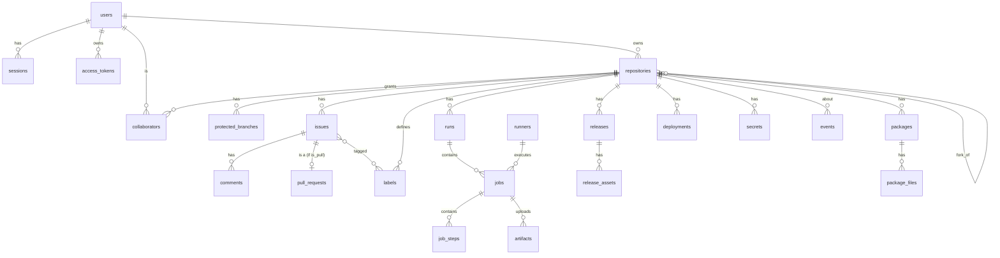

# 05 — Data Model

Anvil stores **metadata in the database** and **bulk data on disk**. Git objects live only in bare repositories managed by `git` ([04](04-git-hosting.md)).

## 1. Conventions

| Convention | Rule |
|---|---|
| Primary keys | `id INTEGER PRIMARY KEY` (SQLite) / `BIGINT GENERATED ALWAYS AS IDENTITY` (PostgreSQL) |
| Timestamps | `INTEGER` Unix time in **milliseconds, UTC**. Portable across SQLite and PostgreSQL, sortable, no timezone bugs. Column names end in `_at`. |
| Booleans | `INTEGER` 0/1 in SQLite, `BOOLEAN` in PostgreSQL. The store layer converts. |
| Enums | `TEXT` with a `CHECK` constraint listing allowed values; the Go constant list in `internal/store/enums.go` is the source of truth |
| JSON | `TEXT` holding JSON; only for data that is never queried by field (labels list, IR snapshot) |
| Case-insensitive names | Store the display value plus a `_lower` column with a `UNIQUE` index |
| Secrets and tokens | Never stored in plain text. Tokens: SHA-256 hash. Secrets: AES-256-GCM ciphertext ([10](10-security.md)) |
| Deletes | Hard delete with `ON DELETE CASCADE`, after the service has removed on-disk data. An `events` row records the deletion for audit. |
| Foreign keys | Always declared; SQLite runs with `PRAGMA foreign_keys = ON` |

## 2. Entity-relationship diagram



## 3. Tables

### 3.1 Identity

**`users`**

| Column | Type | Notes |
|---|---|---|
| id | int PK | |
| username | text | display form, `^[A-Za-z0-9][A-Za-z0-9-]{0,38}$` |
| username_lower | text UNIQUE | lookups |
| email | text UNIQUE | lower-cased |
| full_name | text | |
| password_hash | text | argon2id encoded string (`$argon2id$v=19$m=…`) |
| is_admin | bool | |
| is_active | bool | inactive users cannot sign in; their repos stay visible |
| created_at, updated_at | int | |

**`sessions`** — browser sessions

| Column | Type | Notes |
|---|---|---|
| id_hash | text PK | SHA-256 of the cookie value |
| user_id | FK users | |
| csrf_token | text | random, compared on unsafe methods |
| ip, user_agent | text | shown on the "Sessions" settings page |
| created_at, last_seen_at, expires_at | int | sliding expiry (default 14 days) |

**`access_tokens`** — personal access tokens (PATs)

| Column | Type | Notes |
|---|---|---|
| id | int PK | |
| user_id | FK users | |
| name | text | user label |
| token_prefix | text | first 12 chars, e.g. `anv_pat_3fX9`, shown in UI to identify it |
| token_hash | text UNIQUE | SHA-256 of the full token |
| scopes | text (JSON array) | `repo:read`, `repo:write`, `admin`, `package:write` |
| expires_at, last_used_at, created_at | int | `expires_at` nullable = never |

### 3.2 Repositories

**`repositories`**

| Column | Type | Notes |
|---|---|---|
| id | int PK | also the directory key in logs |
| owner_id | FK users | |
| name, name_lower | text | UNIQUE(owner_id, name_lower) |
| description | text | |
| visibility | enum `public`,`private` | |
| default_branch | text | `main` by default |
| is_empty | bool | true until the first push |
| fork_of_id | FK repositories, nullable | |
| next_index | int | next issue/PR number, incremented in the same transaction that creates the issue |
| size_bytes | int | updated after pushes |
| created_at, updated_at | int | |

**`collaborators`** — PK (repo_id, user_id); `role` enum `read`,`write`,`admin`.

**`protected_branches`**

| Column | Type | Notes |
|---|---|---|
| id | int PK | |
| repo_id | FK | |
| pattern | text | glob, e.g. `main`, `release/*` |
| allow_force_push, allow_delete | bool | |
| require_pull_request | bool | direct pushes rejected in pre-receive |
| required_checks | text (JSON) | job names that must succeed before merge |

### 3.3 Issues and pull requests

Issues and PRs **share one number sequence** per repository (`#1` may be an issue and `#2` a PR), exactly like GitHub. A PR is an `issues` row with `is_pull = 1` plus a `pull_requests` row.

**`issues`**

| Column | Type | Notes |
|---|---|---|
| id | int PK | |
| repo_id | FK | |
| number | int | UNIQUE(repo_id, number), taken from `repositories.next_index` |
| author_id | FK users | |
| title, body | text | body is Markdown, sanitised when rendered |
| state | enum `open`,`closed` | |
| is_pull | bool | |
| closed_at, created_at, updated_at | int | |

**`comments`** — discussion and review comments

| Column | Type | Notes |
|---|---|---|
| id | int PK | |
| issue_id | FK issues | |
| author_id | FK users | |
| body | text | |
| kind | enum `comment`,`review`,`system` | `system` = "alice merged this" |
| commit_sha, path, line, side | nullable | set for inline review comments; `side` is `old`/`new` |
| created_at, updated_at | int | |

**`labels`** (id, repo_id, name, color) and **`issue_labels`** (issue_id, label_id).

**`pull_requests`**

| Column | Type | Notes |
|---|---|---|
| id | int PK | |
| issue_id | FK issues UNIQUE | |
| base_repo_id, base_branch | | target |
| head_repo_id, head_branch | | source (may be a fork) |
| head_sha | text | current head commit |
| merge_status | enum `unknown`,`checking`,`clean`,`conflict` | recomputed in background after pushes |
| conflict_files | text (JSON) | |
| merged_at, merged_by, merge_commit_sha | nullable | |

### 3.4 CI/CD

**`runs`** — one pipeline execution

| Column | Type | Notes |
|---|---|---|
| id | int PK | |
| repo_id | FK | |
| number | int | per-repo sequence shown in the UI (`#42`) |
| source_file | text | `.github/workflows/ci.yml` or `.gitlab-ci.yml` |
| format | enum `github`,`gitlab` | |
| name | text | from the file's `name:` or the file name |
| event | enum `push`,`pull_request`,`tag`,`manual` | |
| ref, commit_sha | text | |
| pull_request_id | FK nullable | |
| trigger_actor_id | FK users | |
| status | enum, see [07 §5](07-ci-cd-design.md) | |
| ir_snapshot | text (JSON) | the parsed IR, so re-runs use exactly the same definition |
| created_at, started_at, finished_at | int | |

**`jobs`**

| Column | Type | Notes |
|---|---|---|
| id | int PK | |
| run_id | FK runs | |
| key | text | job ID in the file (`build`) |
| name | text | display name |
| stage | text nullable | GitLab stage |
| needs | text (JSON) | job keys this job waits for |
| runs_on | text (JSON) | required runner labels |
| status | enum | |
| allow_failure | bool | |
| attempt | int | 1 + number of retries |
| runner_id | FK runners nullable | |
| token_hash | text nullable | job token, valid only while running |
| timeout_seconds | int | default 3600 |
| log_size | int | bytes stored so far, used for idempotent log appends |
| exit_code | int nullable | |
| outputs | text (JSON) | key/values passed to dependent jobs |
| queued_at, started_at, finished_at | int | |

**`job_steps`** — (id, job_id, index, name, status, started_at, finished_at, log_start, log_end). `log_start`/`log_end` are byte offsets into the job log, so the UI can collapse each step.

**`runners`**

| Column | Type | Notes |
|---|---|---|
| id | int PK | |
| name, description | text | |
| token_hash | text UNIQUE | long-lived runner token |
| labels | text (JSON) | e.g. `["windows","x64","deploy"]`; `os`/`arch` labels are added automatically |
| os, arch, version | text | reported at registration |
| scope | enum `instance`,`repo` | |
| repo_id | FK nullable | when scope = repo |
| status | enum `online`,`offline`,`disabled` | derived from `last_seen_at` |
| last_seen_at, created_at | int | |

**`runner_registration_tokens`** — (id, token_hash, scope, repo_id, max_uses, uses, expires_at, created_by).

**`secrets`** — (id, scope `repo`/`instance`, repo_id, name, ciphertext, nonce, created_at, updated_at). UNIQUE(scope, repo_id, name). Names match `^[A-Z_][A-Z0-9_]*$`.

**`artifacts`** — (id, run_id, job_id, name, size, sha256, blob_key, expires_at, created_at).

### 3.5 Publishing

**`releases`** — (id, repo_id, tag_name UNIQUE per repo, target_sha, title, notes, is_draft, is_prerelease, author_id, created_by_job_id nullable, published_at, created_at).

**`release_assets`** — (id, release_id, name UNIQUE per release, size, sha256, content_type, blob_key, download_count, created_at).

**`packages`** — (id, repo_id, name, version, created_by_job_id, created_at). UNIQUE(repo_id, name, version). A published version is **immutable**: files cannot be overwritten, only the whole version deleted.

**`package_files`** — (id, package_id, file_name, size, sha256, blob_key, created_at).

**`deployments`** — (id, repo_id, environment, run_id, job_id, ref, sha, status `in_progress`/`success`/`failure`, url, created_at, finished_at).

### 3.6 System

**`events`** — (id, type, repo_id, actor_kind `user`/`runner`/`system`, actor_id, payload JSON, created_at). Index on (repo_id, id) and (type, id). Pruned after `events.retention_days` (default 90).

**`tasks`** — the durable background work queue

| Column | Type | Notes |
|---|---|---|
| id | int PK | |
| kind | text | `ci.evaluate_push`, `pull.check_mergeable`, `repo.maintenance`, … |
| payload | text JSON | |
| status | enum `pending`,`running`,`done`,`failed` | |
| attempts | int | retried with exponential backoff, max 5 |
| run_after | int | earliest start time |
| locked_until | int | lease; crashed workers' tasks are retried when it passes |
| last_error | text | |
| created_at | int | |

**`settings`** — (key PK, value JSON). Instance settings editable in the admin UI. File config wins over DB settings for keys present in both.

**`schema_migrations`** — (version PK, applied_at).

## 4. On-disk data directory

```
<data_dir>/
├── anvil.db                 # SQLite (plus anvil.db-wal, anvil.db-shm)
├── repos/<owner>/<name>.git # bare repositories
├── logs/<run_id>/<job_id>.log
├── blobs/sha256/<ab>/<cd>/<full_sha256>   # artifacts, release assets, package files
├── tmp/                     # uploads in progress; cleared on startup
└── secret.key               # 32-byte master key for secrets (if not set in config)
```

**Blob store.** Uploaded files are content-addressed by SHA-256. The `blob_key` columns hold the hash. An upload goes to `tmp/` first, is hashed while streaming, then renamed into `blobs/`. Identical files are stored once. A daily garbage collector deletes blobs that no table references.

## 5. Transactions and consistency rules

1. Never hold a database transaction open while running `git` or doing network I/O.
2. When disk and DB must change together (create repo, delete repo, rename), the order is: **do the disk operation in a temp location → commit the DB → move into place**. If the commit fails, remove the temp files. A startup check logs orphaned directories but never deletes them automatically.
3. Number sequences (`next_index`, run `number`) are incremented with `UPDATE … SET next_index = next_index + 1 … RETURNING` in the same transaction as the insert.
4. Job state changes use **conditional updates** (`UPDATE jobs SET status='running' WHERE id=? AND status='queued'`) so two runners can never claim the same job ([07](07-ci-cd-design.md)).
