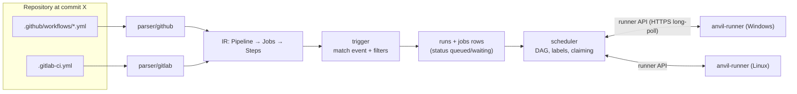
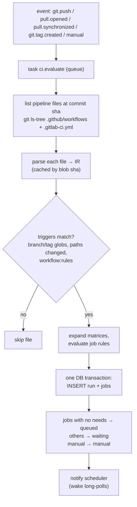
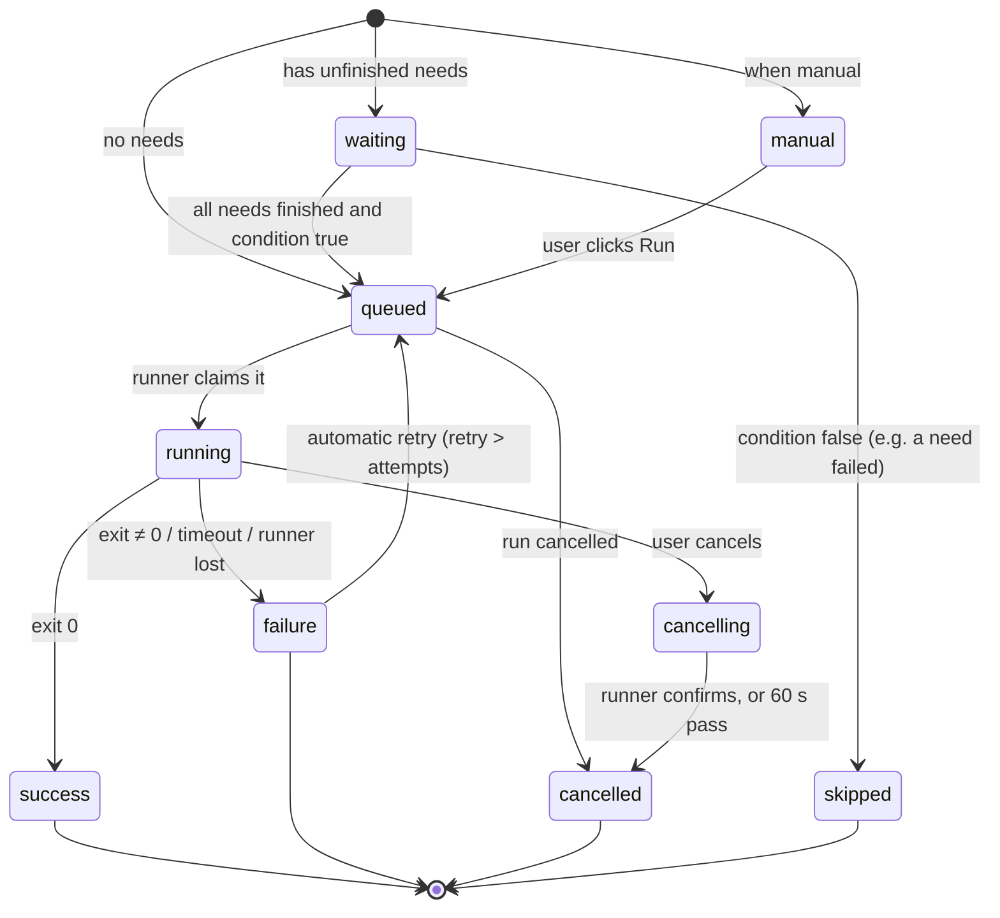
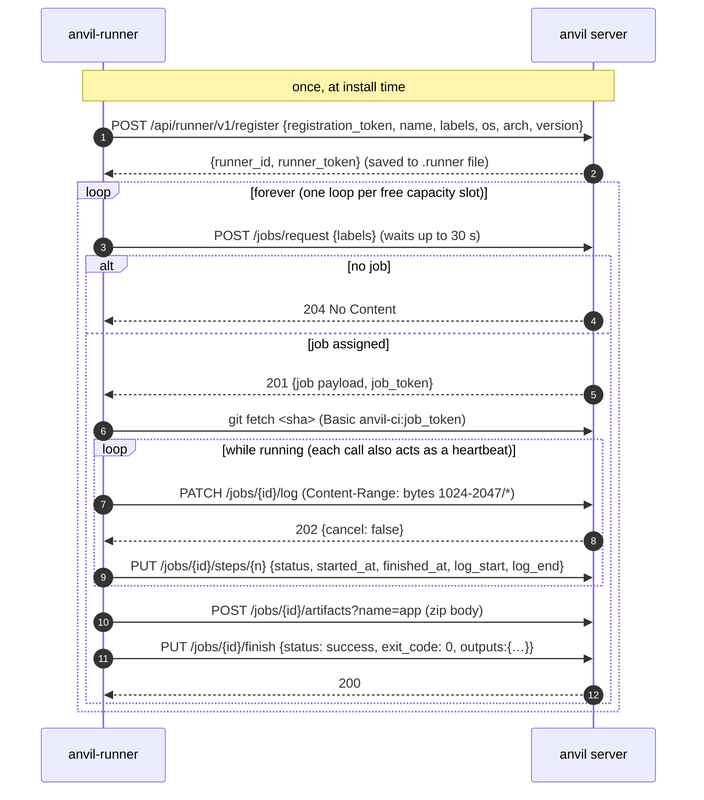
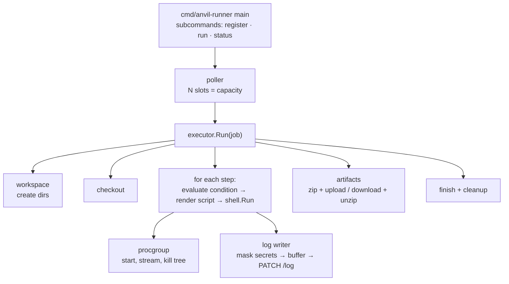

# 07 — CI/CD Engine Design

The CI/CD engine turns a pipeline file in a repository into jobs that run on runner machines, and reports the results back. It has three parts:

1. **Front-end parsers** turn `.github/workflows/*.yml` and `.gitlab-ci.yml` into one internal model, the **IR**.
2. **Server side** (`internal/ci`): the trigger decides which pipelines to start, the scheduler decides which job runs when and where, and the runner API talks to runners.
3. **The runner** (`anvil-runner`) checks out code, runs steps in PowerShell or bash, and streams logs and artifacts back.



## 1. Supported pipeline formats

### 1.1 GitHub Actions style — `.github/workflows/*.yml`

Each `.yml`/`.yaml` file in `.github/workflows/` is a separate pipeline.

| Key | Support | Notes |
|---|---|---|
| `name` | ✅ | |
| `on: push` / `pull_request` with `branches`, `branches-ignore`, `tags`, `paths`, `paths-ignore` | ✅ | glob syntax as GitHub (`*`, `**`, `!`) |
| `on: workflow_dispatch` with `inputs` | ✅ | Manual run from UI/API |
| `on: schedule` | ⏳ after 1.0 | |
| `env` (workflow, job, step) | ✅ | |
| `jobs.<id>.name`, `needs`, `if`, `timeout-minutes`, `continue-on-error`, `env`, `outputs` | ✅ | |
| `jobs.<id>.runs-on` | ✅ | `ubuntu-*` → label `linux`; `windows-*` → `windows`; `macos-*` → `macos`; `self-hosted` ignored; other strings are labels |
| `jobs.<id>.strategy.matrix` (lists, `include`, `exclude`), `fail-fast` | ✅ | expanded into separate jobs when the run is created |
| `jobs.<id>.environment` | ✅ | records a deployment ([08](08-publishing.md)) |
| `steps[].run`, `name`, `shell`, `working-directory`, `env`, `if`, `continue-on-error`, `id` | ✅ | |
| `steps[].uses` | ⚠️ built-ins only | `actions/checkout@*`, `actions/upload-artifact@*`, `actions/download-artifact@*`, `anvil/release@v1`, `anvil/publish-package@v1`. Any other `uses:` fails at parse time with a clear message. |
| `container`, `services` | ❌ | needs Docker; planned with the optional Docker executor |
| Expressions `${{ … }}` | ⚠️ subset | see §3 |

### 1.2 GitLab CI style — `.gitlab-ci.yml`

One file per repository = one pipeline.

| Key | Support | Notes |
|---|---|---|
| `stages` | ✅ | default `[build, test, deploy]` as in GitLab |
| `variables` (global, job) | ✅ | |
| `default` (`before_script`, `after_script`, `tags`, `timeout`) | ✅ | |
| job `stage`, `script`, `before_script`, `after_script` | ✅ | |
| `needs` | ✅ | overrides stage ordering, as in GitLab |
| `tags` | ✅ | runner labels |
| `rules` with `if`, `changes`, `when` | ✅ | `if` uses the same expression subset (§3) |
| `only` / `except` (branches, tags) | ✅ | legacy form |
| `when: on_success / on_failure / always / manual` | ✅ | `manual` = waits for a click (typical for deploy) |
| `allow_failure`, `timeout`, `retry` (count) | ✅ | |
| `artifacts: paths, name, expire_in, when` | ✅ | |
| `dependencies` | ✅ | which artifacts to download |
| `environment: name, url` | ✅ | deployment record |
| `release:` | ✅ | creates a release ([08](08-publishing.md)) |
| `parallel: matrix` | ✅ | same expansion as GitHub matrix |
| `workflow: rules` | ✅ | decides whether the pipeline runs at all |
| `include`, `extends`, YAML anchors | ⚠️ | anchors and `extends` ✅ (resolved by the parser); `include: local` ✅; remote/template includes ❌ |
| `image`, `services` | ❌ | ignored with a warning in the run log (needs Docker) |
| `cache` | ⏳ after 1.0 | |

### 1.3 Same pipeline in both formats

```yaml
# .github/workflows/ci.yml
name: CI
on:
  push: { branches: [main] }
  pull_request: {}
jobs:
  test:
    runs-on: linux
    steps:
      - uses: actions/checkout@v4
      - run: go test ./...
  build:
    needs: test
    runs-on: linux
    steps:
      - uses: actions/checkout@v4
      - run: go build -o dist/app ./cmd/app
      - uses: actions/upload-artifact@v4
        with: { name: app, path: dist/ }
```

```yaml
# .gitlab-ci.yml
stages: [test, build]
test:
  stage: test
  tags: [linux]
  script: [go test ./...]
build:
  stage: build
  tags: [linux]
  script: [go build -o dist/app ./cmd/app]
  artifacts: { name: app, paths: [dist/] }
  rules:
    - if: $CI_COMMIT_BRANCH == "main" || $CI_PIPELINE_SOURCE == "merge_request_event"
```

Both produce the same IR: two jobs, `build` needs `test`, label `linux`, an artifact named `app`.

## 2. The IR (internal pipeline model)

Defined in `internal/ci/model`. The scheduler, runner and UI only see these types.

```go
// Pipeline is a parsed pipeline file, independent of its source format.
type Pipeline struct {
    Name     string
    Source   string            // ".github/workflows/ci.yml"
    Format   Format            // FormatGitHub | FormatGitLab
    Triggers []Trigger         // when this pipeline runs
    Env      map[string]string // pipeline-level environment
    Jobs     []Job             // in file order; dependencies in Job.Needs
    Warnings []string          // unsupported keys that were ignored
}

// Job is one unit of work executed by one runner.
type Job struct {
    Key          string            // unique within the pipeline ("build", "test (linux, 1.24)")
    Name         string
    Stage        string            // GitLab only, for display
    Needs        []string          // keys of jobs that must finish first
    RunsOn       []string          // required runner labels (all must match)
    Condition    Condition         // on_success | on_failure | always | manual, plus optional expression
    Env          map[string]string
    Steps        []Step
    Timeout      time.Duration
    AllowFailure bool
    Retry        int
    Artifacts    []ArtifactSpec    // to upload when the job ends
    Downloads    []string          // artifact names to download before steps run
    Environment  *EnvironmentSpec  // deployment target, if any
    Release      *ReleaseSpec      // GitLab "release:" keyword
    Outputs      map[string]string // output name → expression (GitHub)
    MatrixValues map[string]string // set when expanded from a matrix
}

// Step is one command or built-in action.
type Step struct {
    ID          string
    Name        string
    Kind        StepKind          // StepRun | StepCheckout | StepUploadArtifact | StepDownloadArtifact | StepRelease | StepPublishPackage
    Script      string            // for StepRun
    Shell       Shell             // "", bash, sh, pwsh, powershell, cmd ("" = OS default)
    WorkDir     string
    Env         map[string]string
    With        map[string]string // inputs for built-in actions
    Condition   Condition
    ContinueOnError bool
    CheckEachLine   bool          // GitLab semantics: fail on the first failing script line
}
```

**How GitLab maps to the IR:**

- `before_script` + `script` become one `StepRun` with `CheckEachLine = true`. `after_script` becomes a separate step with `Condition = always`.
- A checkout step is **inserted automatically** first (GitLab always checks out).
- If a job has no `needs`, it needs every job in all earlier stages.

**How GitHub maps:** steps map one-to-one. There is no automatic checkout: the workflow must use `actions/checkout`, exactly as on GitHub.

**Validation at parse time** (errors are shown on the commit and the run is created with status `invalid`):

- Unknown `needs` targets; dependency cycles (found with a depth-first search); duplicate job keys.
- Unsupported `uses:`; empty `script`; invalid YAML. The error includes the line number.

## 3. Expressions

One evaluator (`internal/ci/expr`) handles both `${{ … }}` (GitHub) and `$VAR` / `rules:if` (GitLab).

| Supported | Example |
|---|---|
| Contexts | `github.sha`, `github.ref`, `github.ref_name`, `github.event_name`, `github.actor`, `env.X`, `secrets.X`, `needs.<job>.outputs.<name>`, `needs.<job>.result`, `matrix.<key>`, `inputs.<name>`, `runner.os` |
| GitLab variables in `if` | `$CI_COMMIT_BRANCH == "main"`, `$CI_COMMIT_TAG`, `$CI_PIPELINE_SOURCE`, regex `=~ /^release\//` |
| Operators | `==`, `!=`, `&&`, `\|\|`, `!`, `( )`, `<`, `>` |
| Functions | `success()`, `failure()`, `always()`, `cancelled()`, `contains()`, `startsWith()`, `endsWith()`, `format()`, `toJSON()` |

`${{ }}` in `run:` is substituted **by the runner** right before execution, never by the server, so secrets are not stored in job payloads. Secret values are always masked in logs (§9.5).

## 4. Triggering a pipeline



- **Changed paths** for `paths:` and `changes:` filters come from `git diff --name-only <old> <new>`. For a new branch there is no old commit, so we diff against the default branch.
- **`[skip ci]`** or **`[ci skip]`** in the head commit message skips all pipelines.
- **Pull request events** run against `refs/pull/<n>/head`. Pipelines triggered by a PR **from a fork** do not receive secrets, and their job token is read-only. This is GitHub's rule, and it stops forks from stealing secrets.
- The `pipeline file → IR` result is cached by the file's blob SHA, so unchanged files are not re-parsed.

## 5. Job and run state machines



**Run status** is computed from its jobs after every job change:

| Condition (checked in order) | Run status |
|---|---|
| any job `running`/`cancelling` | `running` |
| any job `queued`/`waiting` | `running` if any job has started, otherwise `queued` |
| any job `cancelled` and run was cancelled | `cancelled` |
| any job `failure` without `allow_failure` | `failure` |
| only `manual` jobs left unfinished | `blocked` (waiting for a manual action) |
| otherwise | `success` |

The commit status shown on commits and PRs combines all runs for that commit, using the worst status.

## 6. Scheduler

`internal/ci/scheduler` owns every job state transition. Nothing else updates `jobs.status`.

### 6.1 Advancing the graph

When a job finishes, `scheduler.onJobFinished(jobID)` runs inside one transaction:

1. For every job in the same run with status `waiting` whose `needs` are all finished, evaluate its condition (`on_success` by default):
   - true → `queued`
   - false → `skipped`. A skipped job counts as finished, so the check repeats until nothing changes.
2. Recompute the run status (§5).
3. After the commit: publish events and wake runners that are waiting for the newly queued labels.

### 6.2 Claiming a job (no double assignment)

```sql
-- candidates for a runner with labels L (JSON-encoded), oldest first
SELECT id, runs_on FROM jobs WHERE status = 'queued' ORDER BY queued_at LIMIT 50;
-- in Go: keep the first job where runs_on ⊆ L, then:
UPDATE jobs
   SET status = 'running', runner_id = :runner, token_hash = :th, started_at = :now
 WHERE id = :id AND status = 'queued';
-- 1 row affected → claimed; 0 rows → another runner won, try the next candidate
```

### 6.3 Long-poll wake-up

Runners call `POST /api/runner/v1/jobs/request`. If nothing matches, the handler waits on a notification channel for up to `ci.long_poll_timeout` (default 30 s) and then returns `204 No Content`. When jobs are queued, the scheduler signals the waiting handlers (**broadcast** to all of them; the claim SQL settles who wins). This gives sub-second job start latency without hammering the database.

### 6.4 Background loops

| Loop | Interval | Action |
|---|---|---|
| Timeout reaper | 15 s | `running` jobs past `started_at + timeout` → `failure` ("timed out"); the runner sees the cancel on its next call |
| Lost runner detector | 30 s | `running` jobs whose runner has been silent for 120 s → `failure` ("runner lost"); retried if `retry` allows |
| Runner status | 30 s | runners not seen for 90 s → `offline` (event `runner.offline`) |
| Artifact expiry | 1 h | deletes expired artifacts' rows; the blob GC removes the files |

## 7. Runner protocol

All calls go over HTTPS, are started by the runner, and send JSON unless noted. The runner identifies itself with `Authorization: Bearer <runner_token>`. Job-scoped calls use `Authorization: Bearer <job_token>`.



### 7.1 Endpoints

| Method | Path | Auth | Purpose |
|---|---|---|---|
| POST | `/api/runner/v1/register` | registration token in body | Returns a long-lived runner token |
| POST | `/api/runner/v1/heartbeat` | runner | When idle, every 30 s; returns config updates |
| POST | `/api/runner/v1/jobs/request` | runner | Long-poll for a job |
| PATCH | `/api/runner/v1/jobs/{id}/log` | job | Append a log chunk. The `Content-Range` start offset must equal the stored `log_size`; duplicates are acknowledged and dropped; a gap → `416` with the current size so the runner can resend |
| PUT | `/api/runner/v1/jobs/{id}/steps/{index}` | job | Step status and log offsets |
| POST | `/api/runner/v1/jobs/{id}/artifacts?name=` | job | Upload a zip |
| GET | `/api/runner/v1/jobs/{id}/artifacts/{name}` | job | Download an artifact from a job this job `needs` |
| PUT | `/api/runner/v1/jobs/{id}/finish` | job | Final status, exit code, outputs. Invalidates the job token. |

Every response to a job-authenticated call includes `"cancel": true|false`. That is how a runner learns that the job was cancelled or timed out.

### 7.2 Job payload

```json
{
  "job_id": 812,
  "run_id": 97,
  "job_token": "anv_job_…",
  "timeout_seconds": 3600,
  "repository": { "full_name": "alice/demo", "clone_url": "https://anvil.local/alice/demo.git" },
  "commit": { "sha": "9f2c…", "ref": "refs/heads/main" },
  "pipeline_format": "github",
  "job": { "...": "the IR Job, with secrets referenced by name only" },
  "secrets": { "DEPLOY_KEY": "…" },
  "variables": { "ANVIL_RUN_NUMBER": "42", "...": "…" },
  "needs_outputs": { "build": { "version": "1.4.0" } }
}
```

Secrets are only ever sent inside this one response, over TLS, to the runner that claimed the job.

## 8. Runner internals (`internal/runner`)



### 8.1 Workspace layout

```
<work_dir>/                       # runner config: work_dir
└── <job_id>/
    ├── src/       ← repository checkout (ANVIL_WORKSPACE, GITHUB_WORKSPACE, CI_PROJECT_DIR)
    ├── tmp/       ← RUNNER_TEMP, TMP/TEMP point here
    ├── scripts/   ← generated step scripts
    └── files/     ← GITHUB_OUTPUT, GITHUB_ENV, GITHUB_PATH files
```

The whole `<job_id>` directory is deleted after the job, unless `keep_workspace = true` for debugging. On Windows, deletion first clears read-only attributes that Git sets on pack files ([12](12-cross-platform.md)).

### 8.2 Checkout

```
git init src
git -C src -c http.extraHeader="Authorization: Basic <b64(anvil-ci:job_token)>" \
    fetch --depth=1 --no-tags origin <sha>
git -C src checkout --force --detach FETCH_HEAD
```

The token is passed with `-c` for each command and is **never** written to `.git/config`, so a later step cannot read it from disk. `actions/checkout` inputs `fetch-depth` and `ref` are honoured.

### 8.3 Running a step

1. Choose the shell: the step's `shell` → the job default → the OS default (Linux: `bash`, falling back to `sh`; Windows: `pwsh` if installed, otherwise Windows PowerShell 5.1 `powershell`).
2. Substitute `${{ }}` expressions.
3. Write the script to `scripts/step-<n>.<ext>` with a preamble:

| Shell | File | Preamble | Invocation |
|---|---|---|---|
| bash | `.sh` | `set -eo pipefail` | `bash --noprofile --norc <file>` |
| sh | `.sh` | `set -e` | `sh <file>` |
| pwsh / powershell | `.ps1` (UTF-8 **with BOM**, required by PowerShell 5.1) | `$ErrorActionPreference='Stop'`; `$ProgressPreference='SilentlyContinue'`; `[Console]::OutputEncoding=[Text.UTF8Encoding]::new($false)` | `powershell -NoLogo -NoProfile -NonInteractive -ExecutionPolicy Bypass -File <file>` |
| cmd | `.cmd` | `@echo off` + `chcp 65001>nul` | `cmd /D /E:ON /V:OFF /S /C "CALL <file>"` |

4. For GitLab jobs (`CheckEachLine`) in PowerShell, the generator adds `if ($LASTEXITCODE -ne 0) { exit $LASTEXITCODE }` after each script line. Without it, PowerShell carries on after a failing program. In bash, `set -e` already gives the same behaviour.
5. Start the process in its own process group (Linux) or Job Object (Windows), with the merged environment ([§8.4](#84-environment-variables)) and the working directory.
6. Merge stdout and stderr in order, pass them through the log writer, wait for exit, record the exit code.
7. Read `GITHUB_OUTPUT`, `GITHUB_ENV` and `GITHUB_PATH` files and apply them to the next steps.

### 8.4 Environment variables

Every job gets three families of variables, whatever its file format, so scripts written for GitHub or GitLab mostly work unchanged.

| Anvil | GitHub-compatible | GitLab-compatible | Value |
|---|---|---|---|
| `CI=true` | `GITHUB_ACTIONS=true` | `GITLAB_CI` is **not** set | |
| `ANVIL_SERVER_URL` | `GITHUB_SERVER_URL` | `CI_SERVER_URL` | `https://anvil.local` |
| `ANVIL_REPOSITORY` | `GITHUB_REPOSITORY` | `CI_PROJECT_PATH` | `alice/demo` |
| `ANVIL_SHA` | `GITHUB_SHA` | `CI_COMMIT_SHA` | full sha (`CI_COMMIT_SHORT_SHA` = 8 chars) |
| `ANVIL_REF` | `GITHUB_REF` | — | `refs/heads/main` |
| `ANVIL_REF_NAME` | `GITHUB_REF_NAME` | `CI_COMMIT_REF_NAME` | `main`; also `CI_COMMIT_BRANCH` or `CI_COMMIT_TAG` |
| `ANVIL_EVENT` | `GITHUB_EVENT_NAME` | `CI_PIPELINE_SOURCE` | `push`, `pull_request` / `merge_request_event`, `web` |
| `ANVIL_RUN_ID` / `ANVIL_RUN_NUMBER` | `GITHUB_RUN_ID` / `GITHUB_RUN_NUMBER` | `CI_PIPELINE_ID` / `CI_PIPELINE_IID` | |
| `ANVIL_JOB` | `GITHUB_JOB` | `CI_JOB_NAME`, `CI_JOB_ID` | |
| `ANVIL_WORKSPACE` | `GITHUB_WORKSPACE` | `CI_PROJECT_DIR` | checkout dir |
| `ANVIL_TOKEN` | `GITHUB_TOKEN` | `CI_JOB_TOKEN` | job token |
| `ANVIL_API_URL` | `GITHUB_API_URL` | — | `https://anvil.local/api/v1` (Anvil's API, not GitHub's) |
| `RUNNER_OS`, `RUNNER_ARCH`, `RUNNER_TEMP` | same | — | `Windows`/`Linux`, `X64`/`ARM64` |

Scripts that call the real GitHub or GitLab REST APIs will not work, because Anvil's API is its own ([00](00-vision-and-scope.md) non-goals).

### 8.5 Secret masking

Before log bytes leave the runner, every secret value (and each line of a multi-line secret) is replaced with `***`. A secret could be split across two chunks, so the writer always **holds back the last `maxSecretLen − 1` bytes** of each chunk until the next one arrives or the step ends.

### 8.6 Cancellation and process trees

A step can start child processes (for example `npm` starting `node`), and killing only the shell would leave them running.

- **Linux:** start with `Setpgid: true`. To cancel: `SIGTERM` to the group (`kill(-pgid)`), wait 10 s, then `SIGKILL`.
- **Windows:** start the process with `CREATE_SUSPENDED` (via `SysProcAttr.CreationFlags`), open it by PID, assign it to a **Job Object** created with `JOB_OBJECT_LIMIT_KILL_ON_JOB_CLOSE`, then resume it with `NtResumeProcess`. Starting it suspended closes the race where the shell could start a child before joining the job. To cancel: `TerminateJobObject`. All children die even if they detached from the console.

Implemented in `internal/runner/procgroup` with `procgroup_windows.go` and `procgroup_unix.go`. These are the only OS-specific files in the runner.

### 8.7 Built-in actions

| `uses:` | Behaviour |
|---|---|
| `actions/checkout@*` | §8.2. Inputs: `fetch-depth`, `ref`, `path` |
| `actions/upload-artifact@*` | Zip `path` (globs, multiple lines) → upload as `name`. Input `retention-days` |
| `actions/download-artifact@*` | Download `name` (or all) from a needed job → unzip into `path` |
| `anvil/release@v1` | Create/update a release; upload `files` globs as assets ([08](08-publishing.md)) |
| `anvil/publish-package@v1` | Upload `files` to the generic registry as `name`/`version` |

The version after `@` is accepted but ignored for `actions/*`, so existing workflows parse unchanged.

## 9. Logs

- **Storage:** append-only file `logs/<run_id>/<job_id>.log`. The server writes chunks at the offset the runner sent and updates `jobs.log_size` in the same operation.
- **Step markers:** step boundaries are kept as byte offsets in `job_steps`, not as text markers, so a log line can never be mistaken for a marker.
- **Live view:** the UI first loads `GET …/log?offset=0`, then subscribes to `…/log/stream` (SSE), which pushes every new chunk and step change. Reconnects resume from `Last-Event-ID` (= byte offset).
- **Limits:** jobs whose log exceeds `ci.max_log_size` (default 50 MiB) keep running, but further output is dropped and a notice is appended.
- **Retention:** logs are kept with their run. Deleting a run deletes its log directory.

## 10. Re-runs, retries and concurrency

- **Retry** (`retry: 2` in GitLab): the failed job goes back to `queued` with `attempt+1`, and the old log is kept as `<job_id>.attempt<n>.log`.
- **Re-run** from the UI creates a **new run** from the stored `ir_snapshot`, either for all jobs or only failed ones (successful jobs are copied with their artifacts).
- **Concurrency per runner:** `capacity` setting (default 1). Each slot runs its own poll loop.
- **Order:** jobs are claimed FIFO by `queued_at`. Priorities are out of scope for 1.0.

## 11. Known limitations (v1.0)

- No container isolation: a job can read anything the runner's OS user can read. **Run the runner as a dedicated low-privilege user** ([10](10-security.md)).
- No cache keyword; no scheduled pipelines; no marketplace actions; no `services:`.
