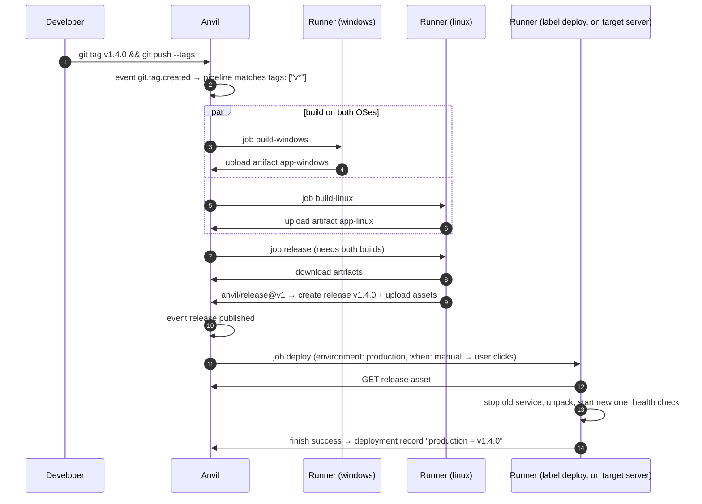

# 08 — Publishing: Artifacts, Releases, Packages and Deployments

"Publishing" means getting the output of a pipeline to the people and machines that use it. Anvil has four mechanisms, from temporary to permanent:

| Mechanism | Lifetime | Who uses it | Example |
|---|---|---|---|
| **Artifact** | Expires (default 30 days) | Later jobs in the same run; developers checking a build | `dist/` zip from the build job |
| **Release** | Permanent, tied to a Git tag | End users downloading a version | `v1.4.0` with `app-windows-x64.zip`, `app-linux-x64.tar.gz` |
| **Package** | Permanent, immutable version | Other pipelines or scripts that fetch by name and version | `mylib/1.4.0/mylib.tar.gz` |
| **Deployment** | A record per environment | Operators: "what version is running in production?" | `production` ← run #42, sha `9f2c…` |

## 1. The full publishing flow



## 2. Artifacts

- Uploaded by `actions/upload-artifact` or GitLab `artifacts: paths`. The runner zips the files, keeping their paths relative to the workspace.
- Stored in the blob store ([05 §4](05-data-model.md)), recorded in `artifacts`.
- Downloaded by later jobs through `actions/download-artifact` or GitLab `dependencies`/`needs`, or by people from the run page.
- `expire_in` / `retention-days` sets the expiry. The default is `ci.artifact_retention_days` (30).
- GitLab `artifacts: when: on_failure|always` is honoured (for example, upload test reports even when the job failed).

## 3. Releases

A release is **a Git tag plus notes plus downloadable files**.

**Create from the UI or the API:** `POST /api/v1/repos/{o}/{r}/releases`. If the tag does not exist yet, it is created on `target` (a branch or sha).

**Create from a pipeline, GitHub style:**

```yaml
- uses: anvil/release@v1
  with:
    tag: ${{ github.ref_name }}
    title: Release ${{ github.ref_name }}
    notes-file: CHANGELOG.md     # or `notes:` inline, or `generate-notes: true`
    files: |
      dist/*.zip
      dist/*.tar.gz
    prerelease: false
```

**Create from a pipeline, GitLab style** (the native `release:` keyword):

```yaml
release_job:
  stage: release
  rules: [{ if: $CI_COMMIT_TAG }]
  script: [echo "Releasing $CI_COMMIT_TAG"]
  release:
    tag_name: $CI_COMMIT_TAG
    name: Release $CI_COMMIT_TAG
    description: ./CHANGELOG.md
    assets:
      links:
        - name: app-linux
          filepath: dist/app-linux.tar.gz   # Anvil extension: uploads the file
```

**Rules:**

- The job token needs `contents: write`. It is granted by default for push and tag events in the same repository, and **never for pipelines from forks**.
- Asset names must be unique within a release. Re-uploading the same name replaces the file only while the release is a draft.
- `generate-notes: true` builds notes from the commit subjects between the previous tag and this one (`git log <prev>..<tag> --format=%s`).
- Each asset stores its SHA-256, which is shown in the UI and returned in the `X-Checksum-Sha256` header so downloads can be verified.

## 4. Generic package registry

A simple registry for any file type, compatible in shape with GitLab's generic packages.

```bash
# Publish (from a job: the job token works; from a laptop: a PAT with package:write)
curl --fail -X PUT \
  -H "Authorization: Bearer $ANVIL_TOKEN" \
  --data-binary @dist/mylib-1.4.0.tar.gz \
  "$ANVIL_API_URL/repos/alice/mylib/packages/generic/mylib/1.4.0/mylib-1.4.0.tar.gz"

# Download
curl -fLO -H "Authorization: Bearer $TOKEN" \
  "$ANVIL_API_URL/repos/alice/mylib/packages/generic/mylib/1.4.0/mylib-1.4.0.tar.gz"
```

On Windows, `curl.exe` ships with Windows 10 and later, so the same commands work in PowerShell (write `curl.exe`, because in Windows PowerShell 5.1 `curl` is an alias for `Invoke-WebRequest`).

- **Immutable:** uploading a file that already exists in a version returns `409`. Publish a new version instead. This guarantees that a version means the same bytes forever.
- Versions must match `^[0-9A-Za-z][0-9A-Za-z.+_-]{0,127}$`; semantic versions are recommended.
- Docker image (OCI) and npm/NuGet/PyPI registries are planned after 1.0 ([17](17-roadmap.md)).

## 5. Deployments

Anvil has **no deploy agent** of its own. A deploy target is simply a machine that runs `anvil-runner` with a label such as `deploy` or `prod-web-1`. The runner already knows how to fetch files from Anvil and run scripts, which is everything a deploy needs.

```yaml
# GitHub style
deploy:
  needs: release
  runs-on: [windows, prod-web-1]
  environment: { name: production, url: http://prod-web-1:8080 }
  steps:
    - run: |
        curl.exe -fL -H "Authorization: Bearer $env:ANVIL_TOKEN" -o app.zip `
          "$env:ANVIL_API_URL/repos/$env:ANVIL_REPOSITORY/releases/latest/assets/app-windows-x64.zip"
        ./deploy/windows-deploy.ps1 -Zip app.zip
```

```yaml
# GitLab style
deploy:
  stage: deploy
  tags: [linux, prod-web-2]
  when: manual
  environment: { name: production, url: http://prod-web-2:8080 }
  script:
    - ./deploy/linux-deploy.sh "$CI_COMMIT_TAG"
```

- A job with `environment` creates a `deployments` row when it starts (`in_progress`) and updates it when it ends.
- The repository's **Environments** page shows what is deployed where and when, with links to the run.
- `when: manual` (GitLab) or a protected `environment` with required approval (planned) gives a human gate before production.
- Reference deploy scripts for both OSes are in `examples/deploy/`. They install the app as a **systemd service** on Linux and a **Windows service** (through `sc.exe`, or NSSM if the app is not service-aware), then health-check `/healthz` and roll back to the previous version if the check fails.

## 6. Example: the demo app's complete pipeline

`examples/demo-app/` is a small Go web server whose pipeline exercises every feature above. It is the end-to-end test of [00 §8](00-vision-and-scope.md). The repo contains `.github/workflows/release.yml` and an equivalent `.gitlab-ci.yml`, and the E2E suite runs both.
