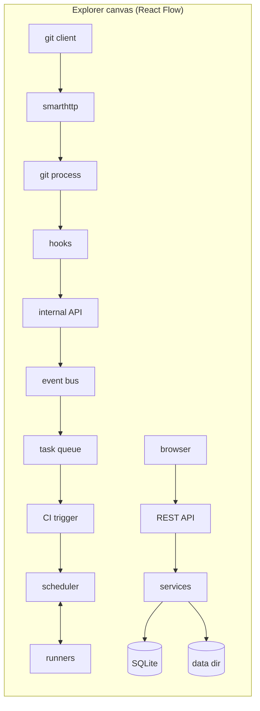

# 09 — Frontend Architecture

The frontend is a **React + TypeScript single-page application** in `web/`. Vite builds it to static files that are embedded in the `anvil` binary with `//go:embed`. In development, Vite's dev server proxies `/api` and the Git routes to a locally running `anvil`.

## 1. Structure

```
web/
├── index.html
├── vite.config.ts
├── src/
│   ├── main.tsx              # entry: providers + router
│   ├── app/                  # app shell: layout, nav bar, error boundary, theme
│   ├── api/
│   │   ├── client.ts         # fetch wrapper: base URL, CSRF header, error mapping
│   │   ├── schema.d.ts       # GENERATED from api/openapi.yaml — do not edit
│   │   └── hooks/            # one file per resource: useRepo, useIssues, useRun…
│   ├── features/             # one folder per product area (pages + feature components)
│   │   ├── auth/             # login, register, tokens, sessions
│   │   ├── repo/             # home, file tree, file view, commits, branches, settings
│   │   ├── issues/
│   │   ├── pulls/            # list, conversation, files changed (diff), merge box
│   │   ├── ci/               # runs list, run graph, job log viewer
│   │   ├── releases/
│   │   ├── packages/
│   │   ├── admin/            # users, runners, settings, task queue
│   │   └── explorer/         # Architecture Explorer (§5)
│   ├── components/           # shared, product-agnostic UI: Button, Dialog, Tabs, Markdown, CodeView, DiffView
│   ├── lib/                  # pure helpers: formatting, sse.ts, markdown.ts (sanitising)
│   └── styles/               # tokens.css (colors, spacing, type), globals.css
└── tests/                    # Playwright end-to-end tests
```

**Rule:** `features/*` may import `components/`, `lib/` and `api/`. `components/` may not import `features/`. One feature never imports another feature's internals; anything shared moves to `components/` or `lib/`.

## 2. Routing

URLs mirror GitHub so they feel familiar:

| URL | Page |
|---|---|
| `/` | Dashboard: your repos, recent activity |
| `/login`, `/register` | Auth |
| `/new` | Create repository |
| `/:owner` | User profile + repos |
| `/:owner/:repo` | Repo home (README, file list) |
| `/:owner/:repo/tree/:ref/*` | Directory |
| `/:owner/:repo/blob/:ref/*` | File |
| `/:owner/:repo/commits/:ref` · `/commit/:sha` | History, one commit |
| `/:owner/:repo/issues` · `/issues/:n` | Issues |
| `/:owner/:repo/pulls` · `/pull/:n` · `/pull/:n/files` | Pull requests |
| `/:owner/:repo/compare/:base...:head` | Compare + "Create PR" |
| `/:owner/:repo/pipelines` · `/pipelines/:id` · `/jobs/:id` | CI |
| `/:owner/:repo/releases` · `/releases/tag/:tag` | Releases |
| `/:owner/:repo/packages` · `/environments` | Packages, deployments |
| `/:owner/:repo/settings/*` | General, collaborators, branches, secrets, runners |
| `/settings/*` | User settings |
| `/admin/*` | Site admin |
| `/explorer` | Architecture Explorer |

The Go server answers any non-API, non-Git `GET` with `index.html`, so deep links work. The router decides what to show.

## 3. State management

| Kind of state | Where it lives |
|---|---|
| Server data (repos, issues, runs…) | **TanStack Query** cache. Query keys mirror API paths, e.g. `['repo', owner, name]` |
| Live data (logs, run status, explorer) | SSE subscriptions (`lib/sse.ts`) that **update the Query cache**, so components never need to know whether data came from a fetch or a push |
| URL state (ref, path, filters, page) | The URL itself (React Router search params). Shareable and survives refresh |
| UI state (dialog open, form input) | Local `useState` |
| Session (current user, CSRF token) | A small React context loaded once from `GET /api/v1/user` |

There is no Redux or other global store: the cache plus the URL cover everything.

## 4. Key components

| Component | Responsibility | Notes |
|---|---|---|
| `Markdown` | Render README, issues, comments | `marked` → **DOMPurify** → HTML. Links get `rel="noopener nofollow"`. Never uses `dangerouslySetInnerHTML` without sanitising. |
| `CodeView` | Syntax-highlighted file with line numbers and line links (`#L10-L20`) | Shiki, highlighting lazily in a Web Worker for large files |
| `DiffView` | Unified and split diffs, inline review comments | Virtualised list for large diffs |
| `PipelineGraph` | Jobs as nodes, `needs` as edges, colour by status | React Flow, automatic layout by stage/level |
| `LogViewer` | Live job log with collapsible steps, ANSI colours, search, line links | Virtualised; handles 100k+ lines |
| `MergeBox` | Merge status, checks, strategy select, merge button | Disabled with a reason when not mergeable |
| `CloneButton` | HTTPS URL + copy + instructions to create a token | |

## 5. Architecture Explorer

The Explorer is an interactive page that shows **how Anvil itself works, live**. It is the main training tool for new developers and a demo for users.

### 5.1 What it shows



- **Topology view:** every component from [03](03-architecture-overview.md) is a node showing live stats from `GET /api/v1/explorer/topology` (requests/min, queue depth, runners online, DB size).
- **Live trace:** when something happens (you push, open a PR, a job starts), an animated dot travels along the edges in the order the server actually processed it. The data comes from `GET /api/v1/explorer/stream`.
- **Click a node:** a side panel explains what the component does, links to its section in these docs and its Go package, and lists the last 20 operations it handled with timings.
- **Replay:** select a past trace (for example "push to alice/demo at 10:42") and step through it span by span, like a debugger.
- **Guided tours:** scripted walkthroughs ("What happens when you `git push`?", "How a job reaches a runner") that highlight nodes in order with explanations taken from these docs.

### 5.2 How the data is produced (backend)

The server records lightweight **trace spans** (not a full tracing system). A span is `{trace_id, span_id, parent_id, component, operation, start, duration, attrs}`.

- Middleware starts a trace for each HTTP request. Git processes, hook calls, queue tasks and scheduler actions add child spans, and the trace ID travels through `context.Context`.
- **Hook calls** carry the trace ID through the environment variable `ANVIL_TRACE_ID`, so the push and its hooks appear as one trace, even though they run in different processes.
- Queue tasks and the jobs they create store the originating trace ID, so the async part (trigger → scheduler → runner) joins the same trace.
- Spans go to an in-memory ring buffer (last 10,000) and are streamed to Explorer subscribers. Nothing is written to the DB unless `explorer.persist = true`.
- Recording uses the standard `context` and `log/slog` patterns, and the span format follows OpenTelemetry naming, so a real OpenTelemetry exporter can be plugged in later ([17](17-roadmap.md)).

## 6. Styling and accessibility

- **Design tokens** in `styles/tokens.css` (colours, spacing, radii, fonts) with light and dark themes switched by `prefers-color-scheme` and a user setting.
- Every interactive element is reachable by keyboard and has a visible focus ring. Dialogs trap focus. Colour is never the only status signal: job status uses both an icon and text.
- Target: WCAG 2.2 AA. Checked by `axe` in the Playwright suite.

## 7. Talking to the API

```ts
// api/client.ts (sketch)
/**
 * Calls the Anvil REST API and returns parsed JSON.
 * Adds the CSRF header to unsafe methods and converts error bodies into ApiError.
 * @throws ApiError with `code` from the server's error envelope (see docs/06-api-spec.md §1).
 */
export async function api<T>(path: string, init: RequestInit = {}): Promise<T> { /* … */ }
```

- Types come from `schema.d.ts`, which is generated from OpenAPI. Never hand-write API response types.
- `401` anywhere → redirect to `/login?next=<current url>`.
- `404` on a page's main resource → the shared Not Found page.

## 8. Build and embedding

```
npm ci && npm run build      # → web/dist/
go build ./cmd/anvil         # embeds web/dist via //go:embed in internal/httpserver/spa
```

Static assets get content-hashed filenames and `Cache-Control: public, max-age=31536000, immutable`. `index.html` is served with `no-cache`.
