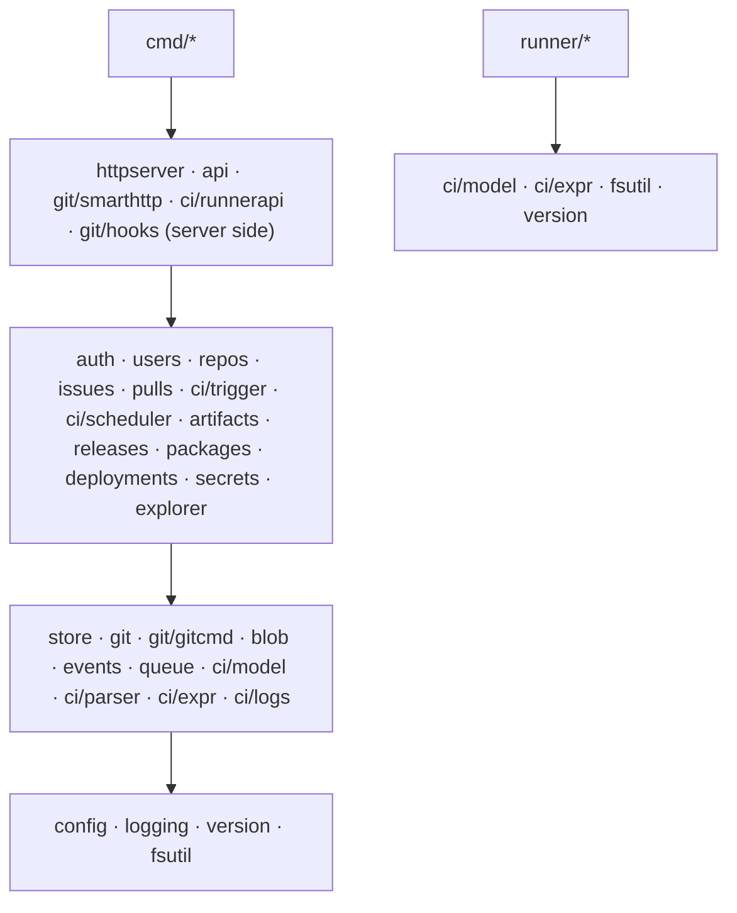

# 14 — Code Structure and Module Reference

This is the map of the codebase: every package, what it owns, what it may depend on, and **every planned exported function with its doc comment**. When implementation starts, these comments are copied into the code as the functions' doc comments, and from then on **the code is the source of truth**. `go doc` and the generated reference site ([15](15-documentation-standards.md)) replace the function lists below. This file then keeps only the package map and the rules.

## 1. Repository layout

```
anvil/
├── cmd/
│   ├── anvil/                 # server binary: main.go + one file per subcommand
│   └── anvil-runner/          # runner binary
├── internal/                  # all Go code (not importable by other modules)
│   ├── config/  logging/  version/  errs/
│   ├── httpserver/            # listener, middleware, SPA embedding
│   ├── api/                   # REST handlers (/api/v1)
│   ├── auth/  users/  repos/  issues/  pulls/
│   ├── git/                   # Repository type + gitcmd/ smarthttp/ hooks/
│   ├── ci/                    # model/ parser/github/ parser/gitlab/ expr/ trigger/ scheduler/ runnerapi/ logs/
│   ├── artifacts/  releases/  packages/  deployments/  secrets/
│   ├── events/  queue/  store/  blob/  explorer/
│   ├── fsutil/  service/      # OS-specific helpers
│   ├── runner/                # everything the runner binary does
│   └── archtest/              # tests that enforce dependency rules
├── api/openapi.yaml           # REST contract
├── web/                       # React frontend (see 09)
├── examples/                  # demo-app, deploy scripts
├── tools/devtool/             # cross-platform dev tasks: go run ./tools/devtool <task>
├── docs/                      # you are here
├── .github/workflows/         # this project's own CI (until Anvil can host itself)
├── go.mod  go.sum
├── CLAUDE.md  README.md  SECURITY.md  CONTRIBUTING.md  CHANGELOG.md
```

**Why `tools/devtool` and not a Makefile or shell scripts?** `make` is not installed on Windows by default, and keeping `.sh` and `.ps1` versions in sync is error-prone. A small Go program runs the same on both: `go run ./tools/devtool build | test | lint | gen | dev | e2e | release`.

## 2. Dependency rules



`internal/archtest` parses the import graph with `go/packages` and fails if:

- a lower layer imports a higher one;
- anything other than `internal/store` imports `database/sql`;
- anything other than `internal/git/gitcmd` imports `os/exec`. The only exceptions are `internal/runner/procgroup`, `internal/runner/shell`, `internal/runner/checkout` (the runner runs git and shells itself) and `internal/service` (calls `systemctl` and `sc.exe`);
- a service package imports `net/http`;
- `internal/runner/...` imports any server package except `ci/model`, `ci/expr`, `fsutil` and `version`.

## 3. Conventions used by every package

- Every exported function takes `ctx context.Context` first if it does I/O.
- Errors: return sentinel/domain errors from `internal/errs` (`errs.NotFound`, `errs.Forbidden`, `errs.Conflict`, `errs.Invalid`) wrapped with `fmt.Errorf("…: %w", err)`. Never `panic` for expected failures.
- Constructors are named `New…` and take a `Deps` struct when there are more than three dependencies.
- Services receive the acting user as an `auth.Actor` parameter and do their own authorization. Handlers never decide permissions.

## 4. Package reference

The signatures below are the **planned public API**. Unexported helpers are documented in code, not here.

### 4.1 `cmd/anvil`

Subcommands are listed in [11 §4](11-configuration-and-operations.md). `main.go` only parses flags and calls `run<Subcommand>(ctx, args) error`. Each subcommand lives in its own file (`serve.go`, `hook.go`, `admin.go`, `backup.go`, `doctor.go`). `serve.go` is the **composition root**: the only place that constructs every service and wires dependencies together. Read it first to see how the whole server fits together.

### 4.2 `internal/config`

```go
// Config is the complete, validated server configuration. See docs/11 §3 for every key.
type Config struct { Server ServerConfig; Storage StorageConfig; Database DatabaseConfig; Git GitConfig; Auth AuthConfig; Security SecurityConfig; CI CIConfig; Explorer ExplorerConfig; Log LogConfig; Mail MailConfig }

// Load reads the TOML file at path, applies ANVIL_* environment overrides, fills defaults,
// and validates the result. It returns an error describing every invalid key, not just the first.
func Load(path string) (*Config, error)

// Default returns a Config with every default value set. Used by `anvil init` to write a commented file.
func Default() *Config

// Validate checks cross-field rules (e.g. internal_addr must be loopback, TLS cert and key set together).
func (c *Config) Validate() error
```

### 4.3 `internal/logging`

```go
// New builds the process-wide slog.Logger from LogConfig (level, text/json, file or stderr).
func New(cfg config.LogConfig) (*slog.Logger, io.Closer, error)

// FromContext returns the request-scoped logger (with request_id, trace_id) or the default logger.
func FromContext(ctx context.Context) *slog.Logger

// WithContext returns a copy of ctx carrying logger l.
func WithContext(ctx context.Context, l *slog.Logger) context.Context
```

### 4.4 `internal/store`

```go
// DB wraps the SQL connection pools. SQLite uses one writer connection and a read pool.
type DB struct{ /* … */ }

// Open opens the database described by cfg and enables foreign keys and WAL mode.
func Open(ctx context.Context, cfg config.DatabaseConfig, dataDir string) (*DB, error)

// Migrate applies every embedded migration newer than the recorded version, each in its own transaction.
// With dryRun it only reports what would run.
func (db *DB) Migrate(ctx context.Context, dryRun bool) ([]string, error)

// Tx runs fn in a write transaction, committing if fn returns nil and rolling back otherwise.
// fn must not call git or do network I/O (docs/05 §5).
func (db *DB) Tx(ctx context.Context, fn func(tx *Tx) error) error

// Close closes all connections.
func (db *DB) Close() error
```

Queries are methods grouped in one file per table (`users.go`, `repos.go`, `issues.go`, `runs.go`, `jobs.go`, …), available on both `*DB` (reads) and `*Tx` (writes). Examples:

```go
// UserByUsername returns the user whose username matches case-insensitively, or errs.NotFound.
func (q *Queries) UserByUsername(ctx context.Context, username string) (*User, error)

// ClaimJob atomically moves a queued job to running for runnerID.
// It returns false (and no error) if another runner claimed it first.
func (q *Queries) ClaimJob(ctx context.Context, jobID, runnerID int64, tokenHash string, now int64) (bool, error)

// NextIssueNumber increments and returns repositories.next_index for repoID. Must run inside Tx.
func (q *Queries) NextIssueNumber(ctx context.Context, repoID int64) (int64, error)
```

### 4.5 `internal/git/gitcmd`

```go
// Cmd describes one invocation of the git binary. Build it with New and the With* methods.
type Cmd struct{ /* args, dir, env, timeout, stdin, stdout, stderr */ }

// Init records the absolute path of the git binary and checks the minimum version (2.38).
// Must be called once at startup; every later Cmd uses this path.
func Init(binary string) (Version, error)

// New starts building a git command. args are passed as an argv list, never through a shell.
// Callers must place user-supplied values after "--end-of-options" or "--".
func New(args ...string) *Cmd

func (c *Cmd) WithDir(dir string) *Cmd
func (c *Cmd) WithEnv(kv ...string) *Cmd
func (c *Cmd) WithTimeout(d time.Duration) *Cmd
func (c *Cmd) WithStdin(r io.Reader) *Cmd

// Output runs the command and returns stdout. On a non-zero exit it returns *ExitError carrying stderr.
func (c *Cmd) Output(ctx context.Context) ([]byte, error)

// Stream runs the command, copying stdout to w as it is produced. Used for packs and archives.
func (c *Cmd) Stream(ctx context.Context, w io.Writer) error
```

### 4.6 `internal/git`

```go
// Repository is a handle to one bare repository on disk. Safe for concurrent use.
type Repository struct{ /* path, cat-file pool */ }

// InitBare creates a new bare repository at path with the given default branch.
func InitBare(ctx context.Context, path, defaultBranch string) error

// Open returns a handle for the bare repository at path, or errs.NotFound if it does not exist.
func Open(path string) (*Repository, error)

// ResolveCommit turns a branch, tag or sha into a full commit sha, or errs.NotFound.
func (r *Repository) ResolveCommit(ctx context.Context, rev string) (string, error)

// ListTree lists the entries of directory path at commit sha (not recursive).
func (r *Repository) ListTree(ctx context.Context, sha, path string) ([]TreeEntry, error)

// ReadBlob returns a reader for the file at path in commit sha, plus its size. Uses the pooled cat-file process.
func (r *Repository) ReadBlob(ctx context.Context, sha, path string) (io.ReadCloser, int64, error)

// Log returns up to opts.Limit commits reachable from rev, optionally limited to a path.
func (r *Repository) Log(ctx context.Context, rev string, opts LogOptions) ([]Commit, error)

// Commit returns one commit with its parents and, if withDiff, the parsed diff against its first parent.
func (r *Repository) Commit(ctx context.Context, sha string, withDiff bool) (*CommitDetail, error)

// Diff returns the parsed diff between base and head (three-dot semantics when threeDot is true).
func (r *Repository) Diff(ctx context.Context, base, head string, threeDot bool) (*Diff, error)

// ChangedPaths lists file paths changed between two commits. Used by CI path filters.
func (r *Repository) ChangedPaths(ctx context.Context, from, to string) ([]string, error)

// Refs lists branches and tags with their target commits.
func (r *Repository) Refs(ctx context.Context, prefixes ...string) ([]Ref, error)

// IsAncestor reports whether ancestor is reachable from descendant (fast-forward check).
func (r *Repository) IsAncestor(ctx context.Context, ancestor, descendant string) (bool, error)

// MergeTree performs a three-way merge without a working tree (git merge-tree --write-tree).
// It returns the resulting tree sha, or the list of conflicting paths.
func (r *Repository) MergeTree(ctx context.Context, baseTip, head string) (tree string, conflicts []string, err error)

// CommitTree creates a commit object from tree with the given parents, message and identities.
func (r *Repository) CommitTree(ctx context.Context, tree string, parents []string, msg string, author, committer Signature) (string, error)

// UpdateRef moves ref to newSHA only if it currently points to oldSHA (compare-and-swap).
// Returns errs.Conflict if the ref moved. oldSHA "" means the ref must not exist.
func (r *Repository) UpdateRef(ctx context.Context, ref, newSHA, oldSHA string) error

// WriteFile commits one file change on top of branch (used by the web editor), returning the new commit.
func (r *Repository) WriteFile(ctx context.Context, branch, path string, content []byte, msg string, author Signature, expectedHead string) (string, error)

// Archive streams a zip or tar.gz of rev to w.
func (r *Repository) Archive(ctx context.Context, rev, format string, w io.Writer) error

// Blame returns line-by-line authorship for path at rev.
func (r *Repository) Blame(ctx context.Context, rev, path string) ([]BlameHunk, error)

// Maintain runs git gc --auto and writes the commit-graph.
func (r *Repository) Maintain(ctx context.Context) error

// Close stops pooled helper processes for this repository.
func (r *Repository) Close() error
```

### 4.7 `internal/git/smarthttp`

```go
// Handler serves the Git smart HTTP protocol for /{owner}/{repo}.git/*.
type Handler struct{ /* repos, auth, explorer tracer, config */ }

func New(deps Deps) *Handler

// ServeHTTP routes to info/refs, git-upload-pack or git-receive-pack after authenticating
// and authorizing the caller (read for upload-pack, write for receive-pack).
func (h *Handler) ServeHTTP(w http.ResponseWriter, r *http.Request)
```

Internal functions, each documented in code: `serveInfoRefs`, `serveRPC`, `writePktLine`, `hookEnv` (builds `ANVIL_*` variables for hooks), `decodeBody` (gzip).

### 4.8 `internal/git/hooks`

```go
// Install writes Anvil's pre-receive, update and post-receive scripts into repoPath/hooks,
// pointing at anvilBinary and configPath. Existing Anvil hooks are overwritten.
func Install(repoPath, anvilBinary, configPath string) error

// RunClient is the body of `anvil hook <name>`: it reads stdin, calls the internal API
// using ANVIL_INTERNAL_URL/TOKEN from the environment, prints messages to stderr,
// and returns the process exit code.
func RunClient(ctx context.Context, name string, stdin io.Reader, stderr io.Writer, env []string) int

// InternalAPI returns the http.Handler mounted on the internal listener (/internal/hooks/*).
func InternalAPI(deps Deps) http.Handler
```

### 4.9 `internal/auth`

```go
// Actor is whoever is making a request: a user, a runner, a job, or anonymous.
type Actor struct{ Kind ActorKind; UserID, RunnerID, JobID, RepoID int64; Scopes []string; IsAdmin bool }

// HashPassword returns an argon2id encoded hash of password.
func HashPassword(password string) (string, error)

// VerifyPassword reports whether password matches encoded, in constant time.
func VerifyPassword(encoded, password string) (bool, error)

// NewToken returns a new random token with the given prefix ("anv_pat_") and its SHA-256 hash.
func NewToken(prefix string) (plain, hash string, err error)

// Login checks credentials and creates a session. Returns the cookie value and CSRF token.
func (s *Service) Login(ctx context.Context, username, password, ip, ua string) (*Session, error)

// Logout deletes the session identified by cookie value.
func (s *Service) Logout(ctx context.Context, cookie string) error

// ActorFromRequest authenticates a request from its session cookie, Bearer token or Basic auth.
// It returns the anonymous Actor (not an error) when no credentials are present.
func (s *Service) ActorFromRequest(ctx context.Context, r *http.Request) (Actor, error)

// CreateToken creates a personal access token for userID and returns the plaintext once.
func (s *Service) CreateToken(ctx context.Context, userID int64, name string, scopes []string, expiresAt *time.Time) (plain string, tok *Token, err error)

// RevokeToken deletes a token owned by userID.
func (s *Service) RevokeToken(ctx context.Context, userID, tokenID int64) error

// Permission returns actor's access level on repo. The only place repo access is computed (docs/10 §2).
func (a *Authorizer) Permission(ctx context.Context, actor Actor, repo *store.Repository) Level

// Require returns errs.NotFound if actor cannot read repo, or errs.Forbidden if they can read but lack level.
func (a *Authorizer) Require(ctx context.Context, actor Actor, repo *store.Repository, level Level) error
```

### 4.10 `internal/users`

```go
func (s *Service) Create(ctx context.Context, actor auth.Actor, in CreateUser) (*User, error)
func (s *Service) Get(ctx context.Context, username string) (*User, error)
func (s *Service) Update(ctx context.Context, actor auth.Actor, username string, in UpdateUser) (*User, error)
// ChangePassword verifies current, sets new, and revokes the user's other sessions.
func (s *Service) ChangePassword(ctx context.Context, actor auth.Actor, current, next string) error
func (s *Service) SetActive(ctx context.Context, actor auth.Actor, username string, active bool) error
func (s *Service) List(ctx context.Context, actor auth.Actor, page Page) ([]User, int, error)
```

### 4.11 `internal/repos`

```go
// Create makes the bare repository on disk and the DB row (docs/05 §5 ordering), installs hooks,
// optionally commits an initial README, and publishes repo.created.
func (s *Service) Create(ctx context.Context, actor auth.Actor, in CreateRepo) (*Repo, error)
func (s *Service) Get(ctx context.Context, actor auth.Actor, owner, name string) (*Repo, error)
func (s *Service) ListForUser(ctx context.Context, actor auth.Actor, owner string, page Page) ([]Repo, int, error)
func (s *Service) Update(ctx context.Context, actor auth.Actor, owner, name string, in UpdateRepo) (*Repo, error)
// Delete removes the repository directory and all rows, after checking the confirmation string.
func (s *Service) Delete(ctx context.Context, actor auth.Actor, owner, name, confirm string) error
func (s *Service) Fork(ctx context.Context, actor auth.Actor, owner, name string) (*Repo, error)
func (s *Service) SetCollaborator(ctx context.Context, actor auth.Actor, owner, name, username string, role auth.Level) error
func (s *Service) RemoveCollaborator(ctx context.Context, actor auth.Actor, owner, name, username string) error
func (s *Service) SaveProtection(ctx context.Context, actor auth.Actor, owner, name string, rule ProtectionRule) error
// ProtectionFor returns the rule that applies to branch, if any (glob match, most specific wins).
func (s *Service) ProtectionFor(ctx context.Context, repoID int64, branch string) (*ProtectionRule, error)
// PathFor returns the on-disk path of a repository and verifies it is inside data_dir/repos.
func (s *Service) PathFor(owner, name string) (string, error)

// Content browsing (content.go) — each checks read permission, then delegates to internal/git:
func (s *Service) Tree(ctx context.Context, actor auth.Actor, owner, name, ref, path string) (*TreeView, error)
func (s *Service) Blob(ctx context.Context, actor auth.Actor, owner, name, ref, path string) (*BlobView, error)
func (s *Service) Commits(ctx context.Context, actor auth.Actor, owner, name, ref, path string, page Page) ([]git.Commit, error)
func (s *Service) Commit(ctx context.Context, actor auth.Actor, owner, name, sha string) (*git.CommitDetail, error)
func (s *Service) Compare(ctx context.Context, actor auth.Actor, owner, name, base, head string) (*CompareView, error)
func (s *Service) Branches(ctx context.Context, actor auth.Actor, owner, name string) ([]Branch, error)
func (s *Service) CreateBranch(ctx context.Context, actor auth.Actor, owner, name, branch, from string) error
func (s *Service) DeleteBranch(ctx context.Context, actor auth.Actor, owner, name, branch string) error
func (s *Service) PutFile(ctx context.Context, actor auth.Actor, owner, name string, in PutFile) (string, error)

// Hook entry points (called by the internal API):
// CheckPush applies branch protection and reserved-ref rules to a pending push.
func (s *Service) CheckPush(ctx context.Context, repoID, pusherID int64, updates []RefUpdate) (allowed bool, message string, err error)
// AfterPush records the push, sets the default branch on first push, and publishes git.* events.
func (s *Service) AfterPush(ctx context.Context, repoID, pusherID int64, updates []RefUpdate) ([]string, error)
```

### 4.12 `internal/issues`

```go
func (s *Service) Create(ctx context.Context, actor auth.Actor, repo RepoRef, in CreateIssue) (*Issue, error)
func (s *Service) Get(ctx context.Context, actor auth.Actor, repo RepoRef, number int64) (*Issue, error)
func (s *Service) List(ctx context.Context, actor auth.Actor, repo RepoRef, f Filter, page Page) ([]Issue, int, error)
func (s *Service) Update(ctx context.Context, actor auth.Actor, repo RepoRef, number int64, in UpdateIssue) (*Issue, error)
func (s *Service) AddComment(ctx context.Context, actor auth.Actor, repo RepoRef, number int64, body string) (*Comment, error)
func (s *Service) EditComment(ctx context.Context, actor auth.Actor, repo RepoRef, commentID int64, body string) (*Comment, error)
func (s *Service) DeleteComment(ctx context.Context, actor auth.Actor, repo RepoRef, commentID int64) error
func (s *Service) SaveLabel(ctx context.Context, actor auth.Actor, repo RepoRef, l Label) (*Label, error)
func (s *Service) DeleteLabel(ctx context.Context, actor auth.Actor, repo RepoRef, labelID int64) error
```

### 4.13 `internal/pulls`

```go
// Open creates the issue + pull_requests rows, writes refs/pull/<n>/head, queues a mergeability check,
// and publishes pull.opened.
func (s *Service) Open(ctx context.Context, actor auth.Actor, repo RepoRef, in OpenPull) (*Pull, error)
func (s *Service) Get(ctx context.Context, actor auth.Actor, repo RepoRef, number int64) (*Pull, error)
func (s *Service) List(ctx context.Context, actor auth.Actor, repo RepoRef, state string, page Page) ([]Pull, int, error)
func (s *Service) Files(ctx context.Context, actor auth.Actor, repo RepoRef, number int64) (*git.Diff, error)
func (s *Service) Commits(ctx context.Context, actor auth.Actor, repo RepoRef, number int64) ([]git.Commit, error)
func (s *Service) Review(ctx context.Context, actor auth.Actor, repo RepoRef, number int64, in Review) error
// CheckMergeable recomputes merge_status with git merge-tree. Runs as a queue task.
func (s *Service) CheckMergeable(ctx context.Context, pullID int64) error
// Merge merges the PR with the chosen strategy using compare-and-swap ref updates (docs/04 §5.3).
func (s *Service) Merge(ctx context.Context, actor auth.Actor, repo RepoRef, number int64, in MergeRequest) (*Pull, error)
func (s *Service) Close(ctx context.Context, actor auth.Actor, repo RepoRef, number int64) error
// OnPush updates refs/pull/<n>/head for open PRs whose head branch moved. Subscribed to git.push.
func (s *Service) OnPush(ctx context.Context, ev events.Event) error
```

### 4.14 `internal/ci/model`, `parser/*`, `expr`

```go
// model: types from docs/07 §2, plus:
// Validate checks job keys, needs targets and cycles. It returns all problems found.
func (p *Pipeline) Validate() []Problem
// TopoOrder returns job keys in dependency order (used for display and validation).
func (p *Pipeline) TopoOrder() ([]string, error)

// parser/github
// Parse converts one .github/workflows file into the IR. Unsupported keys become Warnings;
// unsupported `uses:` and invalid structure are errors with line numbers.
func Parse(data []byte, source string) (*model.Pipeline, error)

// parser/gitlab
// Parse converts .gitlab-ci.yml into the IR: resolves anchors, extends and local includes
// (through readFile), maps stages to needs and injects the automatic checkout step.
func Parse(data []byte, readFile func(path string) ([]byte, error)) (*model.Pipeline, error)

// expr
// Parse compiles an expression in either ${{ }} or GitLab rules:if syntax.
func Parse(src string, syntax Syntax) (Expr, error)
// Eval evaluates e against the given contexts.
func (e Expr) Eval(c *Context) (Value, error)
// Interpolate replaces every ${{ … }} in s. Used by the runner just before running a step.
func Interpolate(s string, c *Context) (string, error)
```

### 4.15 `internal/ci/trigger`

```go
// EvaluatePush is the queue handler for ci.evaluate tasks created from git.push / tag events.
// It lists pipeline files at the new commit, parses them, matches triggers and creates runs.
func (s *Service) EvaluatePush(ctx context.Context, task queue.Task) error

// EvaluatePull does the same for pull.opened / pull.synchronized, applying fork restrictions.
func (s *Service) EvaluatePull(ctx context.Context, task queue.Task) error

// StartManual creates a run for workflow_dispatch / the "Run pipeline" button.
func (s *Service) StartManual(ctx context.Context, actor auth.Actor, repo RepoRef, ref, file string, inputs map[string]string) (*Run, error)
```

### 4.16 `internal/ci/scheduler`

```go
// CreateRun inserts a run and its jobs (matrix already expanded) and queues jobs without needs.
func (s *Service) CreateRun(ctx context.Context, in NewRun) (*Run, error)

// Claim returns a job for a runner with the given labels, waiting up to the long-poll timeout.
// Returns (nil, nil) on timeout.
func (s *Service) Claim(ctx context.Context, runner *Runner) (*Assignment, error)

// AppendLog stores a log chunk at offset for jobID and returns whether the job should be cancelled.
func (s *Service) AppendLog(ctx context.Context, jobID, offset int64, data []byte) (cancel bool, err error)

// UpdateStep records a step's status and log range.
func (s *Service) UpdateStep(ctx context.Context, jobID int64, step StepUpdate) (cancel bool, err error)

// FinishJob records the final result, invalidates the job token and advances the run graph (docs/07 §6.1).
func (s *Service) FinishJob(ctx context.Context, jobID int64, res JobResult) error

func (s *Service) CancelRun(ctx context.Context, actor auth.Actor, runID int64) error
func (s *Service) Rerun(ctx context.Context, actor auth.Actor, runID int64, failedOnly bool) (*Run, error)
// RunManual moves a job from manual to queued.
func (s *Service) RunManual(ctx context.Context, actor auth.Actor, jobID int64) error

// StartLoops starts the timeout reaper, lost-runner detector and runner status loops (docs/07 §6.4).
func (s *Service) StartLoops(ctx context.Context)
```

### 4.17 `internal/ci/runnerapi` and `internal/ci/logs`

```go
// runnerapi.New returns the http.Handler for /api/runner/v1 (endpoints in docs/07 §7.1).
func New(deps Deps) http.Handler

// logs.Store
// Append writes data at offset. A duplicate (offset < size) is ignored; a gap returns ErrGap with the current size.
func (s *Store) Append(ctx context.Context, runID, jobID, offset int64, data []byte) (size int64, err error)
// ReadFrom opens the log of jobID positioned at offset.
func (s *Store) ReadFrom(ctx context.Context, runID, jobID, offset int64) (io.ReadCloser, error)
// Subscribe streams new chunks for jobID until ctx ends or the job finishes.
func (s *Store) Subscribe(ctx context.Context, jobID int64) (<-chan Chunk, error)
```

### 4.18 Publishing: `artifacts`, `releases`, `packages`, `deployments`

```go
// artifacts
func (s *Service) Save(ctx context.Context, jobID int64, name string, r io.Reader, expiresAt time.Time) (*Artifact, error)
func (s *Service) Open(ctx context.Context, actor auth.Actor, artifactID int64) (io.ReadCloser, *Artifact, error)
func (s *Service) ListForRun(ctx context.Context, actor auth.Actor, runID int64) ([]Artifact, error)
func (s *Service) DeleteExpired(ctx context.Context, now time.Time) (int, error)

// releases
func (s *Service) Create(ctx context.Context, actor auth.Actor, repo RepoRef, in CreateRelease) (*Release, error)
func (s *Service) Get(ctx context.Context, actor auth.Actor, repo RepoRef, id int64) (*Release, error)
func (s *Service) ByTag(ctx context.Context, actor auth.Actor, repo RepoRef, tag string) (*Release, error)
func (s *Service) Latest(ctx context.Context, actor auth.Actor, repo RepoRef) (*Release, error)
func (s *Service) Update(ctx context.Context, actor auth.Actor, repo RepoRef, id int64, in UpdateRelease) (*Release, error)
func (s *Service) Delete(ctx context.Context, actor auth.Actor, repo RepoRef, id int64) error
func (s *Service) UploadAsset(ctx context.Context, actor auth.Actor, repo RepoRef, id int64, name string, r io.Reader) (*Asset, error)
func (s *Service) OpenAsset(ctx context.Context, actor auth.Actor, repo RepoRef, id int64, name string) (io.ReadCloser, *Asset, error)
// GenerateNotes builds release notes from commit subjects since the previous tag.
func (s *Service) GenerateNotes(ctx context.Context, repo RepoRef, tag string) (string, error)

// packages
// Put stores one file of name@version. Returns errs.Conflict if that file already exists (immutable).
func (s *Service) Put(ctx context.Context, actor auth.Actor, repo RepoRef, name, version, file string, r io.Reader) (*PackageFile, error)
func (s *Service) Open(ctx context.Context, actor auth.Actor, repo RepoRef, name, version, file string) (io.ReadCloser, *PackageFile, error)
func (s *Service) List(ctx context.Context, actor auth.Actor, repo RepoRef, page Page) ([]Package, int, error)
func (s *Service) DeleteVersion(ctx context.Context, actor auth.Actor, repo RepoRef, name, version string) error

// deployments
func (s *Service) Start(ctx context.Context, jobID int64, env model.EnvironmentSpec) (*Deployment, error)
func (s *Service) Finish(ctx context.Context, jobID int64, success bool) error
func (s *Service) List(ctx context.Context, actor auth.Actor, repo RepoRef, environment string) ([]Deployment, error)
```

### 4.19 `internal/secrets`

```go
// LoadOrCreateKey returns the 32-byte master key from config or <data_dir>/secret.key, creating the file
// with owner-only permissions if neither exists.
func LoadOrCreateKey(cfg config.SecurityConfig, dataDir string) ([]byte, error)
func (s *Service) Put(ctx context.Context, actor auth.Actor, repo RepoRef, name, value string) error
func (s *Service) Delete(ctx context.Context, actor auth.Actor, repo RepoRef, name string) error
// Names lists secret names only; values are write-only.
func (s *Service) Names(ctx context.Context, actor auth.Actor, repo RepoRef) ([]string, error)
// ForJob decrypts the secrets a job may receive (none for fork pull requests).
func (s *Service) ForJob(ctx context.Context, job *store.Job) (map[string]string, error)
```

### 4.20 `internal/events`, `internal/queue`, `internal/blob`

```go
// events.Bus
// Publish stores ev in the events table and delivers it to matching in-process subscribers.
// Delivery to a slow subscriber is dropped rather than blocking (the subscriber sees a gap marker).
func (b *Bus) Publish(ctx context.Context, ev Event) error
// Subscribe returns a subscription receiving events that match f, starting after afterID.
func (b *Bus) Subscribe(ctx context.Context, f Filter, afterID int64) (*Subscription, error)

// queue.Queue
// Enqueue stores a durable task. It survives restarts and is retried with backoff on failure.
func (q *Queue) Enqueue(ctx context.Context, kind string, payload any, opts ...Option) (int64, error)
// Handle registers fn for tasks of kind. Must be called before Start.
func (q *Queue) Handle(kind string, fn func(ctx context.Context, t Task) error)
// Start runs n worker goroutines until ctx is cancelled.
func (q *Queue) Start(ctx context.Context, n int)

// blob.Store
// Put streams r into tmp/, hashing it, then moves it to blobs/sha256/… . Returns the content key.
func (s *Store) Put(ctx context.Context, r io.Reader, maxSize int64) (key string, size int64, err error)
func (s *Store) Open(key string) (io.ReadCloser, error)
// GC deletes blobs for which isReferenced returns false and that are older than one hour.
func (s *Store) GC(ctx context.Context, isReferenced func(key string) (bool, error)) (int, error)
```

### 4.21 `internal/explorer`

```go
// StartSpan begins a trace span for component/operation, returning a ctx that carries it.
// Cheap no-op when the Explorer is disabled.
func StartSpan(ctx context.Context, component, operation string, attrs ...slog.Attr) (context.Context, *Span)
func (s *Span) End(err error)
// TraceIDFromEnv restores a trace from ANVIL_TRACE_ID (used by `anvil hook`).
func TraceIDFromEnv(env []string) (string, bool)
// Topology returns live component stats for GET /api/v1/explorer/topology.
func (e *Explorer) Topology(ctx context.Context) (*Topology, error)
// Handler serves /api/v1/explorer/* (topology, SSE stream, trace replay).
func (e *Explorer) Handler() http.Handler
```

### 4.22 `internal/httpserver` and `internal/api`

```go
// httpserver.New assembles the router: middleware chain, /api/v1, runner API, git smart HTTP,
// explorer, health endpoints and the embedded SPA fallback.
func New(deps Deps) *Server
func (s *Server) Run(ctx context.Context) error      // blocks until ctx is done, then shuts down gracefully

// Middleware (each in its own file with tests):
func RequestID(next http.Handler) http.Handler
func Recover(next http.Handler) http.Handler
func AccessLog(next http.Handler) http.Handler
func Authenticate(a *auth.Service) func(http.Handler) http.Handler
func CSRF(next http.Handler) http.Handler
func RateLimit(cfg RateConfig) func(http.Handler) http.Handler
func Trace(next http.Handler) http.Handler
func SecurityHeaders(next http.Handler) http.Handler

// api: one file per resource (repos.go, issues.go, pulls.go, runs.go, releases.go, …),
// each with a Mount(r chi.Router, deps Deps) function. Shared helpers:
func decodeJSON(r *http.Request, dst any) error        // 1 MiB limit, unknown fields rejected
func writeJSON(w http.ResponseWriter, status int, v any)
func writeError(w http.ResponseWriter, r *http.Request, err error)  // errs.* → HTTP (docs/06 §1)
```

### 4.23 `internal/runner`

```go
// client: typed HTTP client for /api/runner/v1, retrying with backoff on network errors.
func NewClient(baseURL, runnerToken string, http *http.Client) *Client
func (c *Client) Register(ctx context.Context, regToken string, info RunnerInfo) (*Registration, error)
func (c *Client) RequestJob(ctx context.Context, labels []string) (*JobPayload, error) // nil on 204
func (c *Client) AppendLog(ctx context.Context, job *JobPayload, offset int64, data []byte) (cancel bool, err error)
func (c *Client) UpdateStep(ctx context.Context, job *JobPayload, u StepUpdate) (cancel bool, err error)
func (c *Client) UploadArtifact(ctx context.Context, job *JobPayload, name string, r io.Reader) error
func (c *Client) DownloadArtifact(ctx context.Context, job *JobPayload, name string, w io.Writer) error
func (c *Client) Finish(ctx context.Context, job *JobPayload, res JobResult) error

// poller: Run starts `capacity` loops that request and execute jobs until ctx is cancelled.
func Run(ctx context.Context, cfg Config, c *Client) error

// executor: Execute runs one job end to end (workspace → checkout → steps → artifacts → finish).
func Execute(ctx context.Context, c *Client, job *JobPayload, cfg Config) JobResult

// workspace
func NewWorkspace(workDir string, jobID int64) (*Workspace, error)
func (w *Workspace) Cleanup() error  // uses fsutil.RemoveAll (read-only files, Windows locks)

// checkout: Checkout fetches exactly job.Commit.SHA into dir using the job token per command.
func Checkout(ctx context.Context, job *JobPayload, dir string, opts CheckoutOptions) error

// shell
func Detect() Shells                                   // which shells exist on this machine
func Render(step model.Step, sh Shell, checkEachLine bool) (file string, content []byte, args []string)

// procgroup (procgroup_windows.go / procgroup_unix.go)
func Start(cmd *exec.Cmd) (*Group, error)              // starts cmd in its own group / Job Object
func (g *Group) Wait() (exitCode int, err error)
func (g *Group) Kill() error                            // kills the whole process tree

// logwriter: NewMasker returns an io.Writer that masks secrets and forwards chunks to sink.
func NewMasker(secrets []string, sink func([]byte) error) *Masker
func (m *Masker) Flush() error

// actions: built-in `uses:` implementations (docs/07 §8.7)
func RunBuiltin(ctx context.Context, step model.Step, env *JobEnv) error
```

### 4.24 `internal/fsutil` and `internal/service`

```go
// RemoveAll is os.RemoveAll that also clears read-only attributes and retries on Windows sharing violations.
func RemoveAll(path string) error
// ReplaceFile atomically replaces dst with src (MoveFileEx on Windows, rename on Unix).
func ReplaceFile(src, dst string) error
// RestrictToOwner makes path readable and writable only by the current user (0600 / owner-only ACL).
func RestrictToOwner(path string) error

// service
func Install(name, displayName, exe string, args []string) error   // systemd unit or Windows service
func Uninstall(name string) error
// RunAsServiceIfNeeded detects being started by the Windows SCM and runs main under its control.
func RunAsServiceIfNeeded(name string, main func(ctx context.Context) error) (handled bool, err error)
```

## 5. Frontend modules

See [09 §1](09-frontend-architecture.md) for the folder layout. Every exported function, hook and component has a TSDoc comment ([15](15-documentation-standards.md)). The main hooks are one per API resource (`useRepo`, `useTree`, `useBlob`, `useIssues`, `usePull`, `useRun`, `useJobLog`, `useExplorerStream`, …), each documenting its query key and cache invalidation rules.
