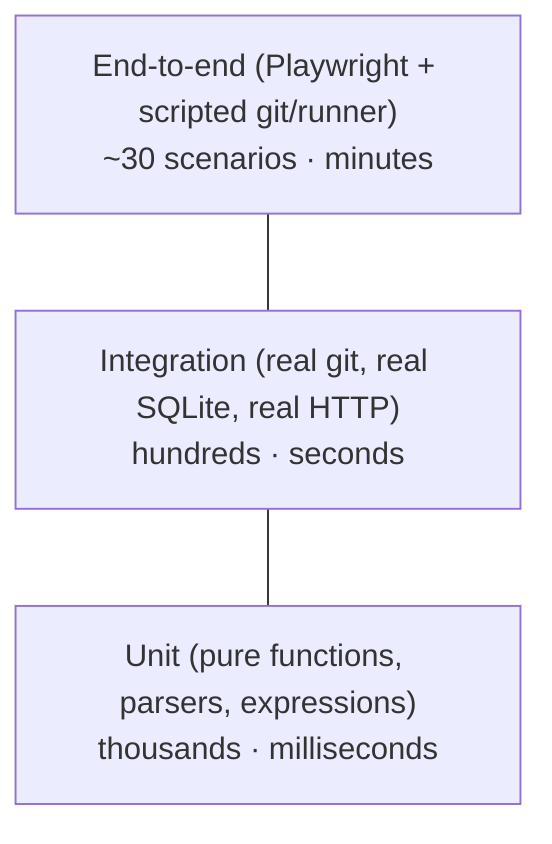

# 16 — Testing Strategy

## 1. Test pyramid



| Level | What | Tools | Runs |
|---|---|---|---|
| Unit | Parsers, expression evaluator, pkt-line writer, authz rules, status derivation, masking, shell rendering | `go test`, Vitest | every commit |
| Integration | A service with a real DB in `t.TempDir()`, real `git` binary, real HTTP server (`httptest`) | `go test -tags integration` | every commit |
| End-to-end | Full `anvil` + `anvil-runner` binaries, browser, real `git clone/push` | Playwright, Go test harness | every PR, both OSes |
| Cross-platform | All of the above on Windows **and** Linux | CI matrix | every PR |
| Security | `govulncheck`, `npm audit`, fuzzing of parsers and pkt-line | Go fuzzing (`go test -fuzz`) | nightly |
| Performance | Clone/push of a 1 GB repo, 100 concurrent long-polls, log streaming at 1 MB/s | Go benchmarks + scripted scenarios | before each release |

## 2. Rules

- Every bug fix starts with a test that fails before the fix.
- No test may depend on network access, the developer's global Git config, or the current time without injecting a clock. Git commands in tests run with `GIT_CONFIG_GLOBAL` and `GIT_CONFIG_SYSTEM` pointing at empty files.
- Tests use `t.TempDir()` and must pass in parallel (`t.Parallel()`) on both OSes.
- Coverage target: 80% lines for `internal/ci`, `internal/auth`, `internal/git`. No hard target elsewhere, but every exported function has at least one test.
- Run the race detector (`-race`) on Linux CI.

## 3. Important test suites

| Suite | Covers |
|---|---|
| `parser/github/testdata/*.yml` + golden `*.ir.json` | Each supported key; every unsupported key produces the documented warning or error |
| `parser/gitlab/testdata` | Same, plus anchors, `extends`, `include: local`, stage → needs mapping |
| **Format parity** | Pairs of GitHub/GitLab files that must produce identical IR |
| `smarthttp` integration | clone, shallow clone, fetch, push, force push rejected, protocol v0/v2, gzip bodies, auth failures, large push (100 MB) |
| `hooks` integration | protection rules via a real `git push`, messages shown to the client, trace ID propagation |
| `pulls` integration | mergeable / conflict / base moved during merge (CAS) / squash |
| `scheduler` | DAG advance, skipped propagation, `when: always`, manual jobs, matrix, two runners racing for one job (exactly one wins), timeout, lost runner, retry |
| `runner` | Shell rendering per shell; exit codes; GitLab per-line failure in PowerShell; process-tree kill (a step that starts a grandchild sleep); masking across chunk boundaries; log resend after a network error |
| `archtest` | Dependency rules ([14 §2](14-code-structure.md)) |
| `docs` | Config keys ⇔ [11](11-configuration-and-operations.md); routes ⇔ OpenAPI; Markdown links resolve |

## 4. End-to-end scenarios (selection)

1. Register admin → create repo → clone → push → see files in UI.
2. Open PR from branch → pipeline runs → review comment → merge → pipeline runs on main.
3. Merge conflict shown with file list.
4. Fork PR: pipeline waits for approval; after approval it has no secrets.
5. **Demo app release ([08 §6](08-publishing.md))**: tag → builds on a Windows runner *and* a Linux runner → release with both assets → manual deploy job → deployment recorded. Run once with the GitHub-style file and once with the GitLab-style file.
6. Cancel a running job → its child processes are gone (checked through the OS process list).
7. Server restart during a running job → job continues and finishes; queued tasks are not lost.
8. Architecture Explorer: a push produces a trace with spans smarthttp → git → hook → internal API → event → trigger → scheduler → runner.

## 5. The project's own CI

Until Anvil can host itself, the project runs CI on GitHub Actions (`.github/workflows/ci.yml`) with an OS matrix:

```yaml
strategy:
  matrix:
    os: [ubuntu-latest, windows-latest]
steps:
  - go run ./tools/devtool lint
  - go run ./tools/devtool test        # unit + integration
  - go run ./tools/devtool e2e         # builds binaries, starts server + runner
```

**Milestone "dogfooding"** ([17](17-roadmap.md), Phase 5): the same workflow file runs on Anvil itself, on one Windows and one Linux runner. From then on, Anvil builds Anvil.
