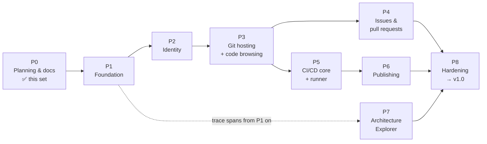
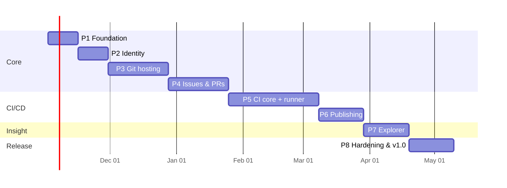

# 17 — Roadmap

The work is split into phases. **Each phase ends with something usable and demoable**, its tests passing on Windows and Linux, and its docs updated from "planned" to "implemented".

## 1. Phase overview

P4 and P5 can run in parallel with two developers. P7's UI can be built by a frontend developer as soon as P3 emits trace spans.

## 2. Estimated timeline (illustrative)

Estimates assume **one experienced full-time developer** and an assumed start on 2 Nov 2026. With two developers (backend + frontend), expect roughly 60% of the calendar time. These are planning numbers: revisit them at the end of each phase.

Total ≈ 27 weeks for one developer.

## 3. Phases in detail

### P0 — Planning and documentation ✅

- Deliverables: this documentation set (docs 00–17), tech decisions (ADRs), repository skeleton.
- Exit: docs reviewed and accepted by the project owner.

### P1 — Foundation (≈ 2 weeks)

**Build**
- Go module, folder layout ([14 §1](14-code-structure.md)), `tools/devtool` (build, test, lint, dev).
- `internal/config`, `logging`, `version`, `errs`, `fsutil`.
- `internal/store` with migrations and the first tables (`schema_migrations`, `settings`, `events`, `tasks`).
- `internal/events`, `internal/queue`, the `explorer.StartSpan` no-op skeleton.
- `internal/httpserver` with middleware, `/healthz`, `/readyz`, `/api/v1/version`, SPA embedding.
- Frontend skeleton: Vite + React + router + app shell + theme; served by the binary.
- `anvil serve`, `init`, `migrate`, `doctor`, `version`.
- Project CI on GitHub Actions: lint + test on Windows and Linux; `archtest`; docs link check.

**Exit criteria:** `anvil init && anvil serve` works on Windows and Linux and shows the empty SPA; CI green on both OSes.

### P2 — Identity (≈ 2 weeks)

**Build:** users, argon2id passwords, sessions + CSRF, PATs, `auth.Authorizer`, rate limiting, admin user commands, login/register/settings/tokens UI, admin users page, audit events.

**Exit criteria:** sign in, create a PAT, call `/api/v1/user` with it; security tests for CSRF, session fixation, enumeration.

### P3 — Git hosting and code browsing (≈ 4 weeks)

**Build:**
- `gitcmd` (version check, timeouts, argument safety), `git.Repository` with the `cat-file` pool.
- Repo create/update/delete/rename, collaborators, `repos.PathFor`.
- Smart HTTP (v0/v2, gzip, streaming), hook install + `anvil hook` + internal API, branch protection.
- UI: repo home + README, file tree, file view (Shiki), commits, commit diff, branches/tags, clone button, web file editor.
- Trace spans for every step of a push.

**Exit criteria:** clone, push, force-push rejection on protected branch, and browsing all work from both OSes; a 1 GB repository clones correctly.

### P4 — Issues and pull requests (≈ 4 weeks)

**Build:** issues, comments, labels, Markdown rendering (sanitised); PRs (same repo and fork), `refs/pull/<n>/head`, mergeability via `merge-tree`, merge + squash with CAS, review comments on diff lines, compare page, activity feed.

**Exit criteria:** the PR flow in E2E scenarios 2–3 ([16 §4](16-testing-strategy.md)) passes.

### P5 — CI/CD core and runner (≈ 6 weeks) — *the biggest phase*

**Build:**
- IR, GitHub parser, GitLab parser, expression evaluator, format-parity tests.
- Trigger (push, PR, tag, manual; path filters; `[skip ci]`), scheduler (DAG, claim, long-poll, loops), runner API, log store + SSE.
- `anvil-runner`: register, poll, workspace, checkout, shell rendering (bash/sh/pwsh/powershell/cmd), procgroup for both OSes, masking, built-in checkout and artifact actions, service install.
- Secrets (encrypted), fork-PR restrictions, protected labels.
- UI: pipelines list, run graph (React Flow), live log viewer, commit/PR status checks, runner admin pages, secrets settings.
- **Dogfooding milestone:** Anvil's own CI runs on Anvil with one Windows and one Linux runner.

**Exit criteria:** the demo app pipeline passes in both formats on both OSes; cancellation kills process trees; the scheduler race tests pass 1,000 times in a loop.

### P6 — Publishing (≈ 3 weeks)

**Build:** blob store + GC, artifacts with expiry, releases (UI, API, `anvil/release@v1`, GitLab `release:`), generic package registry, deployments + environments page, `examples/demo-app` with deploy scripts for systemd and Windows services.

**Exit criteria:** E2E scenario 5 (tag → multi-OS build → release → manual deploy) passes on both OSes.

### P7 — Architecture Explorer (≈ 3 weeks)

**Build:** span recording everywhere (HTTP, git, hooks via `ANVIL_TRACE_ID`, queue, scheduler, runner), ring buffer, topology + stream + replay endpoints, Explorer UI (canvas, live animation, node panels linked to docs and packages, replay, three guided tours).

**Exit criteria:** E2E scenario 8; a new developer can complete onboarding Day 1 using only the Explorer and the docs.

### P8 — Hardening and v1.0 (≈ 3 weeks)

**Build:** backup/restore, `/metrics`, performance tests and fixes, fuzzing campaign, `govulncheck`, accessibility pass, install guide verified on clean Windows 11 and Ubuntu VMs, release packaging (zip/tar.gz + checksums), `SECURITY.md`, `CHANGELOG.md`, generated reference docs site.

**Exit criteria:** every success criterion in [00 §8](00-vision-and-scope.md) is met. **Tag v1.0.0, released by Anvil's own pipeline.**

## 4. After 1.0 (candidate features, unordered)

| Feature | Notes |
|---|---|
| SSH Git transport | Built-in SSH server (`golang.org/x/crypto/ssh`), user SSH keys |
| Organizations and teams | Org-owned repos, team permissions |
| Webhooks | Outgoing HTTP on events, with SSRF protection |
| Optional Docker/Podman executor | Container isolation and `container:`/`image:` support where Docker exists |
| CI cache keyword, scheduled pipelines | `cache:`, `on: schedule` |
| PostgreSQL support | Second driver in `internal/store` |
| OCI container registry, npm/NuGet/PyPI registries | Extends the package registry |
| Git LFS | Large files |
| Repository mirroring (pull from GitHub/GitLab) | Import existing projects |
| OpenTelemetry exporter | Send Explorer spans to Jaeger/Tempo |
| Wiki, project boards | |
| macOS official support | Already cross-compiles |

## 5. Risks

| Risk | Impact | Mitigation |
|---|---|---|
| Windows process and file locking edge cases | Flaky runners, failed cleanups | Isolated in `procgroup`/`fsutil`; dedicated stress tests on Windows CI from P1 |
| Scope creep in CI format compatibility | P5 overruns | Supported subset fixed in [07 §1](07-ci-cd-design.md); anything else → clear parse error + post-1.0 list |
| No container isolation for jobs | Security incidents on shared runners | Clear docs and UI warnings, dedicated runner users, protected labels, fork approval; Docker executor post-1.0 |
| SQLite write contention at scale | Slow under heavy CI load | Single writer + short transactions; PostgreSQL driver post-1.0; load tests in P8 |
| Git version differences on user machines | Broken features | Hard minimum 2.38 checked at startup; CI tests against the minimum and the latest Git |
| Docs drift from code | Onboarding fails | Lint gates, PR checklist, docs tests ([15 §6](15-documentation-standards.md)) |

## 6. How progress is tracked

- One milestone per phase in Anvil (or GitHub until dogfooding), with issues for each deliverable.
- Each phase ends with a short demo and a review of this roadmap: update estimates, move features between phases if needed, and record the change in a dated note at the bottom of this file.

## Change log of this roadmap

- 2026-10-30 — Initial roadmap (P0 complete).
